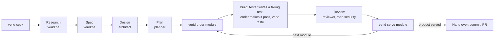

```
 ██╗   ██╗ ███████╗ ██████╗  ██╗ ██████╗
 ██║   ██║ ██╔════╝ ██╔══██╗ ██║ ██╔══██╗
 ██║   ██║ █████╗   ██████╔╝ ██║ ██║  ██║
 ╚██╗ ██╔╝ ██╔══╝   ██╔══██╗ ██║ ██║  ██║
  ╚████╔╝  ███████╗ ██║  ██║ ██║ ██████╔╝
   ╚═══╝   ╚══════╝ ╚═╝  ╚═╝ ╚═╝ ╚═════╝
     hook-enforced TDD for Claude Code and Codex · RAW → COOKING → PLATED
```

# verid: TDD for Claude Code and Codex

**English** · [Tiếng Việt](README.vi.md)

> The agent does the work. verid verifies it. The developer approves.

## Why

Coding agents in a hurry skip the test: they write the code first, or weaken a test until it goes green. A prompt can ask for TDD; a hook can refuse the write. verid holds Claude Code and Codex to RED → GREEN → REFACTOR, named RAW → COOKING → PLATED, and only counts test runs it made itself as evidence. It fails closed, only the developer can open an exception (Claude Code only), and a hash-chained audit log records it. Codex's host limits are listed under Limitations.

## Install

Requirements: Node.js 22 or later, and [Claude Code](https://claude.com/claude-code) or Codex CLI (tested with 0.164.0).

```powershell
# Windows (PowerShell 5.1+)
irm https://raw.githubusercontent.com/anhtranhai835/verid/main/install.ps1 | iex
```

```sh
# macOS / Linux
curl -fsSL https://raw.githubusercontent.com/anhtranhai835/verid/main/install.sh | sh
```

The installers check Node 22+, install verid with npm, add the verid plugin when `claude` is on PATH, then ask for a project folder and run `verid cook` (only with a terminal and `CI` empty, `false` or `0`; never in the home folder). Pin a release with `VERID_VERSION` (default `latest`): `$env:VERID_VERSION = '1.1.0'` before the PowerShell command (clear it with `Remove-Item Env:VERID_VERSION`), or `... | VERID_VERSION=1.1.0 sh`.

By hand: `npm install -g @anhtranhai835/verid`, then for Claude Code:

```bash
claude plugin marketplace add anhtranhai835/verid
claude plugin install verid@verid
```

The plugin is all Claude Code needs: architect, planner, tester, coder, QA, reviewer and security agents, and the BA, onboard, design, plan, build, TDD, debugging, review, security, edge-case, problem-solving and predict skills. From a clone: `npm ci`, `npm run build`, `npm link` (or the `bun` equivalents). Hooks point at the installed `dist/`, so run `verid upgrade --yes` in each project after upgrading, moving the clone or switching between npm and a clone.

Optional ClaudeKit-derived references are also bundled: backend-development, frontend-development, databases, devops, mobile-development, web-testing, react-best-practices, mcp-builder, context-engineering, ui-ux-pro-max, security-scan and docs-seeker. Each `verid:<name>` skill has a short verid workflow wrapper and the original material under its own folder. Use only the ones relevant to the project; they do not change module approval or TDD gates.

Optional read-only ClaudeKit-derived helper agents are `verid:brainstormer`, `verid:technical-researcher`, `verid:code-simplifier`, `verid:docs-manager`, `verid:ui-ux-designer`, `verid:project-manager` and `verid:debugger`. They can advise the main thread without taking a mapped role or changing evidence and approval gates.

## Quick start

In your own terminal, in the project to guard:

```bash
verid cook     # pick providers, language, mode, architecture and, in prep and recipe, drive
verid stock    # remix only: record the tests that already fail
```

Open your provider and say what you want (for Codex, trust the hooks first, see Providers and Codex). Every verid message names the next step; `verid menu` shows where the project stands.

Commit `.verid/manifest.yaml`, `.verid/.gitignore`, `.verid/rules/`, `.verid/docs/`, `.verid/log/`, the providers' instruction files (`CLAUDE.md` / `AGENTS.md`), `.claude/commands/verid/` for Claude Code and, in prep and recipe, `.verid/research.md`, `.verid/spec.md`, `.verid/design.md` and `.verid/plan.md`. Keep `.claude/settings.local.json` and `.codex/hooks.json` local: they name this machine's verid. `.verid/feedback.md`, if the agent started one, is an append-only log of friction with verid itself (confusing denials, unclear skills, stuck drives, workarounds); read it and commit or share it as you choose. A teammate runs `verid cook` once after cloning, then asks the agent for `verid:onboard`: a read-only table of each repo's stack, test command and globs (with any manifest lines worth changing, for you to edit), a health check and a short briefing of where the project stands.

## How you work with verid

verid splits the work between you (the developer, in your own terminal), the main conversation of your agent, and the agents mapped in `roles`. The hook stands between the agent and your files at every step.



| Step          | Who                           | What happens                                                                                                                                                                                 |
| :------------ | :---------------------------- | :------------------------------------------------------------------------------------------------------------------------------------------------------------------------------------------- |
| 1. Set up     | developer                     | `verid cook` writes `.verid/`, the instruction block and the hooks; remix adds `verid stock`                                                                                                 |
| 2. Research   | main conversation, `verid:ba` | reads your documents in `.verid/docs/`, asks you one question at a time and writes `.verid/research.md` (problem, scope, Glossary, Clarifications)                                           |
| 3. Spec       | main conversation, `verid:ba` | writes `.verid/spec.md`: REQ, NFR and SEC requirements in EARS form with their sources, abuse cases, data classes and what is out of scope; you agree it                                     |
| 4. Design     | architect                     | settles architecture decisions one at a time, inventories existing code, proposes boundaries, a module map with dependencies and interfaces, agrees them with you, writes `.verid/design.md` |
| 5. Plan       | planner                       | splits the work into modules of testable ACs that cite the spec's IDs (`- AC-1: … (REQ-1)`), `product` last with end-to-end ACs, in `.verid/plan.md`                                         |
| 6. Order      | developer                     | `verid order <module>` approves one module: production code opens for it alone                                                                                                               |
| 7. Build      | tester, coder                 | per AC: the tester writes a failing test named with the AC code, `verid taste` records the failure (RAW → COOKING), the coder makes it pass (→ PLATED) and refactors                         |
| 8. Review     | reviewer, security            | read-only reviews of the module from a snapshot packet; each ends with `Verdict: pass` or `Verdict: fail`                                                                                    |
| 9. Serve      | developer                     | `verid serve <module>` closes it when every AC has a passing test, the last run is current and the reviews passed                                                                            |
| 10. Hand over | main conversation             | after `product` is served: commit, push and open a PR following `.verid/rules/git.md`; you merge                                                                                             |

- **remix** (existing code and tests) skips research, spec, design and plan: record the baseline with `verid stock`, then build in the same cycle.
- **auto drive** (prep and recipe): you sign research, the spec (when there is one) and design once with `verid order`; verid then reviews the plan, orders and serves each module itself and stops for you only when something is stuck or a question needs you (`.verid/blocked.md`).
- **Codex** has one writer: the main agent writes tests and code through the same gate, and a read-only `verid_reviewer` reviews.
- When something goes wrong, the agent appends it to `.verid/feedback.md`; you read it.

## The cycle

1. **No production code without a failing test first.** Production code is locked while the cycle is RAW and, in prep and recipe, while no module is approved. While a test fails, the tests are frozen.
2. **Evidence before claims.** Only a `verid taste` run whose exit code and JUnit report agree counts. In the human drive the agent cannot stop while the last run fails or after a change no run has seen; the auto drive holds every Stop itself.
3. **Only the developer opens an exception.** In Claude Code, `/verid tip` works only with a person at the keyboard, never from a subagent or `claude -p`. Each exception lets one action past one rule, once. Codex cannot create overrides.

| State             | Production code    | Tests           | `verid taste` fails                                                           | `verid taste` passes |
| :---------------- | :----------------- | :-------------- | :---------------------------------------------------------------------------- | :------------------- |
| RAW (RED)         | locked             | writable        | → COOKING on a new assertion failure; → RAW · stub on a test that cannot load | stays RAW            |
| RAW · stub (RED)  | open, for the stub | writable        | → COOKING on an assertion failure; stays while a test cannot load             | → RAW                |
| COOKING (GREEN)   | open               | frozen          | stays COOKING                                                                 | → PLATED             |
| PLATED (REFACTOR) | open               | writable, → RAW | → COOKING                                                                     | stays PLATED         |

- Only a failure the previous run did not have moves the cycle. A new conversation starts in RAW; `verid garnish` opens a refactor-only one.
- Put the AC code in the name of the test that covers it: `AC-1 adds two numbers`, or `AC_1_addsTwoNumbers` where a name cannot hold a dash.
- In remix, baseline tests are known failures outside the cycle; one that passes leaves the baseline for good.

## Modes and drives

| Mode     | Starts from             | verid adds                                                                   |
| :------- | :---------------------- | :--------------------------------------------------------------------------- |
| `prep`   | an idea, no code yet    | research, design, then approved, reviewed and served modules, `product` last |
| `recipe` | a specification         | the same steps, with modules taken from the specification                    |
| `remix`  | existing code and tests | a baseline of the tests that failed before verid                             |

**Iterations** (optional, prep and recipe): `iterations` in the manifest groups the plan into calendar windows. In interactive `verid cook`, each iteration lasts 14 days, Enter accepts today as the start date, and the demo falls on the last day; CLI flags or the manifest can set another schedule. A module may start with one `Iteration: <n>` line right after its heading; with iterations off it is not parsed. `verid menu` and session start show the current iteration, its dates, the countdown to demo day, modules served/total and late modules. Iterations are guidance: they change neither gates nor module order.

**Drive.** `drive: human` (default) leaves approving and serving modules to you. `drive: auto` needs reviewer, tester and coder roles on Claude Code (only a reviewer for Codex-only projects):

- Closing a module needs the same evidence as `verid serve`. Auto works with or without Git; it never creates branches, requires commits or waits for merges.
- Three failed plan, module or security reviews, three failing coder rounds on one AC, or consecutive Stop holds without progress stop the drive. Text in `.verid/blocked.md` is latched in protected state, so deleting it does not resume; neither does editing a served module's plan section.
- `verid order` resumes: it resets counters, removes the blocked file and clears current reviews. `verid order <module>` and `verid serve` are refused in auto. Press Esc to ask the agent something; the next normal Stop continues.
- Research, spec or design hash changes warn without locking code; signing a changed spec again sends the plan back to review.

## Providers and Codex

`providers` defaults to `[claude-code]`. Choose during `verid cook`, or repeat `--provider` (`verid cook --provider claude-code --provider codex --mode prep --yes`); for an existing project edit `providers` in the manifest and run `verid upgrade --yes`.

Cook and upgrade only touch the block between `<!-- verid:begin -->` and `<!-- verid:end -->` in `CLAUDE.md` (Claude Code) and `AGENTS.md` (Codex); the block puts the hard rules first, then the TDD cycle, workflow, commands, state, the allowlists when the manifest adds to them, and the feedback log, each under its own heading, and `verid doctor` reports a missing or edited one. No skill or agent is copied into the project.

For Codex, cook writes `.codex/hooks.json` (PreToolUse, UserPromptSubmit, Stop, SubagentStop, SessionStart, with timeouts) and merges a marked `[agents.verid_reviewer]` block into `~/.codex/config.toml` (or `$CODEX_HOME/config.toml`), leaving other TOML alone. Then open Codex in the project, trust the project and trust every verid hook in `/hooks`, and run `verid doctor`. Repeat the `/hooks` review after `verid upgrade --yes`. Setup never writes a trust bypass.

On Codex:

- The main agent writes tests and code under the same TDD gate; the tester/coder split is off. Dispatch `verid_reviewer` with `fork_turns: "none"`, the module/AC identifiers and the plan, design and review-packet paths; its SubagentStop message records the review.
- Denials use JSON with exit 0 and Stop holds use `decision: "block"`. PowerShell labeled `Bash` meets the Bash rules plus PowerShell write-target checks; every `apply_patch` target meets path, role and TDD rules; a patch handed to the shell is denied, because its working folder is invisible to the hook.
- Supported tools: `Bash`, `apply_patch`, `collaborationspawn_agent`, `collaborationwait_agent`, `update_plan`, `Read`, `Grep`, `Glob` and MCP tools (`mcp__*`). Other tools, malformed patches and unreadable dynamic shell forms are denied.
- Skill allowlists are advisory and `/verid tip` has no effect; use `verid peek` and `verid menu` in the terminal.

## Layouts

`monorepo` (default) is one project tree with repo paths relative to its root. A `workspace` is a folder without its own `.git` that contains separate repos:

```text
project/ (.git)              workspace/ (no .git)
├── api/                    ├── api/ (.git)
├── web/                    ├── web/ (.git)
├── .verid/                 ├── .verid/ (.git)
└── .claude/                └── .claude/ (per machine)
```

Workspace `CLAUDE.md` / `AGENTS.md` live at the workspace root, outside the shared `.verid` repo. They are per machine; `verid cook` regenerates their verid blocks while preserving user text.

- **Detection.** Cook picks a workspace when the folder is outside any git work tree (or its ancestor repo is rooted at your home folder, for dotfiles) and has at least one child repo; `--layout monorepo|workspace` decides for a new manifest, and an existing manifest keeps its layout. Workspace setup is refused inside any other git repo. Home is Node's `os.homedir()` (`USERPROFILE` on Windows).
- **Sharing.** Cook makes `.verid/` a git repo without committing and records each child's origin with credentials removed (only the passwordless SSH user `git@` is kept); `default_branch` comes only from local `origin/HEAD`. A teammate clones it as `workspace/.verid` and runs `verid cook` from `workspace/`, which clones the missing repos (`https`, `ssh`, `git` and local `file` only; network shares and remotes starting with `-` are refused). Open the agent at the workspace root.
- **Clones.** The preview lists each clone as `path <- remote (branch)`; Git can prompt and has no timeout. Cook keeps existing folders, continues after a failure and exits 1 if any clone failed or a remote is missing. A marker under `.verid/.state/clones/` tracks each clone; a marked folder is accepted once `HEAD` is a commit and the index matches it, otherwise it is an incomplete clone (Ctrl-C included): finish or remove it and re-run. Repos without commits are valid.
- **Repos.** Globs and `verid taste` run relative to each repo, which all share one TDD cycle. qa writes any repo's `e2e_globs`; the build skill uses the `role: frontend` repo, or a `role: e2e` one. Git audit covers every listed repo and `.verid`.

## Conventions: architecture and Git

Cook asks for an architecture, `ddd` (default), `clean`, `layered` or `none` (`--architecture` without a terminal), and writes project-owned rules: `.verid/rules/architecture.md`, `.verid/rules/git.md` and `.verid/rules/workflow.md`. Upgrade adds missing files and keeps your edits. These conventions are advisory: verid reports departures and never blocks a tool call, an order, `serve` or auto for them.

- **Architecture.** The architect adapts `.verid/design.md` to the chosen profile; the reviewer checks it. A repo may set `architecture_check` (`command`, `inputs`, optional `timeout_sec`); after a passing suite `verid taste` runs it and records the result. A failing, missing or unrun checker only warns.
- **Screens.** A module that changes what users see carries a `Screens:` block in `.verid/plan.md`: verid:plan draws 2–3 ASCII wireframes per changed screen, you pick one, and the module keeps the chosen one with its states, so ordering the module approves the screen too. Its e2e tests check the chosen wireframe's elements and labels, and the reviewer compares the UI code with it.
- **Session log.** After each AC the main conversation appends a dated entry to `.verid/log/<module>.md`: what passes, decisions and why, deviations from the plan, commits and what comes next. Session start, clear, compact and resume name the open module's log, so a new conversation picks up where the last one stopped. The log is guidance; nothing checks it.
- **Dependencies.** A module may name the modules it builds on in a `Depends: api, auth` line before its first AC, listed above it in the plan. `verid menu` shows `waits for …` and suggests ordering a module only once they are served; `verid doctor` warns `DEPENDS` about an unknown, self or later name, and `verid order` of a module whose dependencies are not served says so and records `ORDER_DEPENDS`. None of this blocks; the auto drive opens modules in file order.
- **Spec.** `.verid/spec.md` holds REQ, NFR and SEC requirements; each AC cites the IDs it proves, e.g. `- AC-1: adds two numbers (REQ-1)`, and a `Review Focus:` line can say why an ID has none. `verid menu` counts and `verid doctor` lists `SPEC_UNCOVERED` (a live requirement no AC or Review Focus line cites) and `SPEC_UNKNOWN` (a cited ID the spec lacks or has dropped). These only warn; `[NEEDS CLARIFICATION: …]` in the spec is an open question like one in the plan.
- **Git.** `.verid/rules/git.md` describes Conventional Commits, one complete change per commit, `feat/`, `fix/`, `chore/`, `docs/`, `refactor/` or `test/` branches, one PR per branch, squash-merging and deleting merged branches. `verid menu`, `serve`, auto Stop and `doctor` warn about main or badly named branches, uncommitted changes, invalid messages and unreadable history. Set branch protection and squash-only merging on GitHub yourself; verid works offline.
- **Review packets.** `verid menu --commits` shows the open module's history and diffs without secret files or protected state; `--file` writes it to `.verid/review/work.md` and prints only the path. Reviewers get that path, the module/AC codes and the plan/design paths, and read the files themselves. Agents can read the packet but not write it; regenerate it after fixes.
- **Invalidation.** Later code or test writes seen by the hook and a new order clear a module review; any project write outside `.verid/` clears a security review. Commits alone do not. The hook still blocks writes to Git internals.

## Commands

| Command                             | Who                       | What it does                                                                                                                                               |
| :---------------------------------- | :------------------------ | :--------------------------------------------------------------------------------------------------------------------------------------------------------- |
| `verid cook [--dry-run] [--yes]`    | developer                 | sets up this project and machine; offers an older manifest its new defaults                                                                                |
| `verid upgrade [--dry-run] [--yes]` | developer                 | adds missing manifest defaults, regenerates verid's commands and refreshes this machine's hook paths                                                       |
| `verid doctor`                      | anyone                    | offline, read-only check of Node, repos, Git, runners, hooks, instruction blocks, plugins, role agents and the audit log's hash chain; exits 1 on problems |
| `verid taste`                       | agent                     | runs the tests, then each configured architecture check after a passing suite; only these runs count as evidence                                           |
| `verid peek`                        | anyone                    | the cycle, the next step, and why the last run did not count                                                                                               |
| `verid menu [--commits [--file]]`   | anyone                    | research, modules and AC coverage, open questions, audits and the next step; `--commits` adds the open module's history and diffs                          |
| `verid stock`                       | developer                 | remix: records the failing tests as the baseline                                                                                                           |
| `verid order [module]`              | developer                 | human: approves a module of `.verid/plan.md`, signing `.verid/design.md` too; auto: signs research, spec and design, or resumes a stop                     |
| `verid serve <module>`              | developer                 | human drive: closes the open module once every AC passes, the last run is current and the reviews (and security, when mapped) passed                       |
| `verid garnish`                     | developer                 | opens production code for a conversation that only refactors                                                                                               |
| `verid halt [reason]`               | developer                 | kill switch: denies every agent tool call, past any `/verid tip`, and holds no Stop until `verid resume`                                                   |
| `verid resume`                      | developer                 | lifts `verid halt`                                                                                                                                         |
| `/verid:tip <reason>`               | developer, in Claude Code | asks to let the action just blocked through, with a one-time code                                                                                          |
| `/verid:confirm <code>`             | developer, in Claude Code | lets that exact action through once                                                                                                                        |
| `/verid:peek`, `/verid:menu`        | developer, in Claude Code | what `verid peek` and `verid menu` show, to you only                                                                                                       |

- `verid cook` takes repeatable `--provider claude-code|codex`, `--mode prep|recipe|remix`, `--drive human|auto`, `--layout monorepo|workspace`, `--architecture`, `--lang vi|en`, `--test-cmd`, repeatable `--src`/`--tests`, and in prep or recipe `--iterations --duration "2 weeks" --start-date 2026-10-12 --demo-day Friday` (all three). Once a manifest exists, these are ignored with a note: edit `.verid/manifest.yaml`.
- Cook and upgrade show a file tree before writing (`+` create, `~` modify, `=` keep, `!` advisory) and ask `Apply? (Y/n)`; if files change meanwhile they show the new plan and ask again. `--dry-run` writes nothing; `--yes` accepts the defaults, including a suggested mode (prep, or remix when `src/`, `lib/` or `app/` exists). Without a terminal cook needs an explicit mode or an existing manifest, and upgrade needs `--yes`. Upgrade replaces local edits to the four generated commands; cook keeps them.
- Developer commands refuse to run inside Claude Code and recognized Codex shells, and the hook blocks recognizable developer calls.

## What the hook blocks

| Rule                                 | Overridable        | Covers                                                                                                                                                                                                                                                                                                               |
| :----------------------------------- | :----------------- | :------------------------------------------------------------------------------------------------------------------------------------------------------------------------------------------------------------------------------------------------------------------------------------------------------------------- |
| `VERID_BURNT_STATE_PROTECTED`        | no                 | reading or writing `.verid/.state/`, writing `.verid/review/`, or overwriting the `.verid/` root                                                                                                                                                                                                                     |
| `VERID_BURNT_HALTED`                 | no                 | any tool call while the developer has run `verid halt`                                                                                                                                                                                                                                                               |
| `VERID_BURNT_SECRET_PROTECTED`       | no                 | secret files: `.env*` (not templates), keys, certificates, `.ssh/`, `.npmrc`…                                                                                                                                                                                                                                        |
| `VERID_BURNT_TRANSCRIPT_PROTECTED`   | no                 | Claude Code transcripts in `~/.claude/projects/` or `CLAUDE_CONFIG_DIR/projects/`                                                                                                                                                                                                                                    |
| `VERID_BURNT_HOOK_PROTECTED`         | no                 | writing project/home `.claude/settings*.json`, any `.claude.json` or `.mcp.json` (MCP server lists), `.claude/agents/`, `.claude/plugins/`, project `.claude/skills/` / `~/.claude/skills/` and `.claude/commands/` / `~/.claude/commands/`, the same paths under `CLAUDE_CONFIG_DIR`, verid's `dist/` and `plugin/` |
| `VERID_BURNT_MANIFEST_PROTECTED`     | yes                | writing `.verid/manifest.yaml`                                                                                                                                                                                                                                                                                       |
| `VERID_BURNT_DOCS_PROTECTED`         | yes                | writing in `.verid/docs/`, the developer's documents                                                                                                                                                                                                                                                                 |
| `VERID_BURNT_INSTRUCTIONS_PROTECTED` | yes                | changing or removing the verid block in a provider's instruction file                                                                                                                                                                                                                                                |
| `VERID_BURNT_PATCH_UNSUPPORTED`      | no on Codex        | malformed or unknown `apply_patch` syntax, including environment routing, or a patch handed to the shell                                                                                                                                                                                                             |
| `VERID_BURNT_TOOL_UNSUPPORTED`       | no on Codex        | a non-MCP Codex tool outside the supported list; the message names it                                                                                                                                                                                                                                                |
| `VERID_BURNT_AGENT_CONTEXT`          | no on Codex        | reviewer dispatch with `fork_turns` other than `"none"`                                                                                                                                                                                                                                                              |
| `VERID_BURNT_BASH_NESTED_CODEX`      | yes in Claude Code | a shell starting a nested `codex`                                                                                                                                                                                                                                                                                    |
| `VERID_BURNT_BASH_NESTED_CLAUDE`     | yes                | Bash starting a nested `claude`                                                                                                                                                                                                                                                                                      |
| `VERID_BURNT_BASH_DEVELOPER_ONLY`    | yes                | Bash naming `CLAUDECODE` or verid's hook, or running a developer command                                                                                                                                                                                                                                             |
| `VERID_BURNT_BASH_DANGEROUS`         | yes                | downloading or decoding code and running it in one command (`curl …                                                                                                                                                                                                                                                  | sh`, `bash <(curl …)`, `irm … | iex`, `base64 -d | sh`, `powershell -enc`), `git --no-verify`or`core.hooksPath`, `sudo`, `doas`, RunAs, and `chmod` setuid/setgid |
| `VERID_BURNT_SHELL_UNSUPPORTED`      | yes in Claude Code | Claude Code's unsupported shells, or Codex dynamic PowerShell forms whose command cannot be read                                                                                                                                                                                                                     |
| `VERID_BURNT_ROLE_READ_ONLY`         | yes                | any write by the mapped reviewer or security reviewer                                                                                                                                                                                                                                                                |
| `VERID_BURNT_ROLE_TESTER_ONLY`       | yes                | split: a test written by anyone but the tester (or qa, for end-to-end tests)                                                                                                                                                                                                                                         |
| `VERID_BURNT_ROLE_CODER_ONLY`        | yes                | split: production code written by anyone but the coder                                                                                                                                                                                                                                                               |
| `VERID_BURNT_PLAN_NOT_APPROVED`      | yes                | production code while no module is open (prep, recipe)                                                                                                                                                                                                                                                               |
| `VERID_BURNT_AUTO_NO_MODULE`         | yes                | auto: production code while no module is open                                                                                                                                                                                                                                                                        |
| `VERID_BURNT_AUTO_STUCK`             | yes                | auto: production code and tests while the drive is stuck                                                                                                                                                                                                                                                             |
| `VERID_BURNT_TDD_NO_FAILING_TEST`    | yes                | production code while the cycle is RAW                                                                                                                                                                                                                                                                               |
| `VERID_BURNT_TDD_TEST_FROZEN`        | yes                | a test while the cycle is COOKING                                                                                                                                                                                                                                                                                    |
| `VERID_BURNT_GIT_INTERNALS`          | no                 | any write inside a repository's `.git` folder: refs, configuration, hooks                                                                                                                                                                                                                                            |

The rules cover file tools, Bash (its plain write targets are judged like a Write), MCP tools, Claude Code's `Skill`, `Agent` and `Task`, and Codex's `apply_patch` and `collaborationspawn_agent`. Codex also protects project/home `.codex/`, project/home `.agents/skills/` and verid's `plugin/` folder, treats `~/.codex/sessions/`, `history.jsonl` and its state databases as transcripts and `~/.codex/auth.json` as a secret, including a relocated `CODEX_HOME`. Unexpected errors inside verid block the call.

Roles: with a tester and a coder mapped, only the coder writes production code and only the tester (or qa, for end-to-end tests) writes tests; main and unknown agents cannot take either permission. Reviewer and security write nothing. The scope of the drafting roles (architect, planner, qa) and the known skill/agent lists are advisory: departures are audited, not blocked. A role needs the host's subagent identity.

## manifest.yaml

```yaml
schemaVersion: 1
mode: remix # prep | recipe | remix
providers: [claude-code] # optional: claude-code, codex; defaults to [claude-code]
architecture: ddd # ddd | clean | layered | none
allowed_skills: [] # optional additions: exact names or prefix:*
allowed_agents: [] # extra exact agent types; mapped roles are already known
roles: # optional: agent types, as the host reports them, for each role
  reviewer: ["verid:reviewer"]
  tester: ["verid:tester"] # with both a tester and a coder, the work is split
  coder: ["verid:coder"]
  architect: ["verid:architect"] # optional: only .verid/design.md
  planner: ["verid:planner"] # optional: only .verid/plan.md
  qa: ["verid:qa"] # optional: only end-to-end tests
  security: ["verid:security"] # optional: a module closes only on its Verdict: pass
drive: human # human | auto
layout: monorepo # monorepo | workspace; defaults to monorepo when absent
# iterations: { duration: "2 weeks", start_date: "2026-10-12", demo_day: Friday } # prep, recipe only
# git: { default_branch: main, protected_refs: ["refs/heads/release"] } # optional, for the Git audit
repos:
  - path: .
    # remote: https://example.com/team/api.git  # optional: clone a missing repo
    # default_branch: main  # optional: this repo's main for the Git audit
    # role: backend  # optional: frontend | backend | e2e | other
    # test_cmd: make test JUNIT={junit}   # optional: without it verid finds the runners
    source_globs: ["**"] # production code
    test_globs: ["**/test/**", "**/*.test.*", …] # tests and runner config
    ignore_globs: ["**/*.md", "**/*.json", …] # never production code
    e2e_globs: ["**/e2e/**", "**/*.e2e.*"] # end-to-end tests
    timeout_sec: 100 # optional
    # architecture_check: { command: "npm run architecture", inputs: [".dependency-cruiser.cjs"] } # optional
```

- Only the developer edits the manifest. `verid cook` writes defaults where every file is code unless it is a test, a document, data, config, a build file or a tool's folder.
- A path matching `test_globs` or `e2e_globs` is a test; else one matching `ignore_globs` is free; else one matching `source_globs` is code. Globs support `**`, `*`, `?`; a folder is `src/**`. An AC written `- AC-3 (e2e): …` needs a passing end-to-end test: any test Playwright reports, or another runner's test whose file matches `e2e_globs`.
- `providers` is a nonempty list of `claude-code` and/or `codex`. Known skills default to `verid:*`; `allowed_skills` adds exact names (`team:lint`) or namespaces (`team:*`). Agent dispatch knows the bundled read-only helpers, the types in `roles`, and `allowed_agents`. Dispatch outside these lists is audited; it never gives an agent a role or bypasses write rules.
- To use superpowers optionally, install it yourself and add `allowed_skills: ["superpowers:*"]`; mapped `roles` and the TDD gate still apply, and extra agent types go in `allowed_agents` explicitly.
- A name in `roles` has one role, and a tester needs a coder on Claude Code. Without `roles`, nobody is held to a role and `verid serve` refuses for want of a reviewer. Cook offers missing optional roles to older mappings, adds `verid_reviewer` to `roles.reviewer` when Codex is selected, and keeps your names. A Codex-only project maps no `security`: its one reviewer also checks security with `verid:security`.
- The retired `roles.researcher` field is rejected with repair guidance: remove it, run `verid cook`, and use `verid:ba` in the main conversation.
- `iterations`: `duration` is a positive integer plus `day(s)` or `week(s)`, `start_date` a real `YYYY-MM-DD`, `demo_day` `Monday` to `Sunday` (case-sensitive).
- Repo paths are relative, distinct and non-overlapping (`./x`, `x/` and repeated separators are normalized); absolute paths, parent traversal, Windows aliases and linked workspace repos are refused. Each repo has its own globs, command and timeout; `remote`, `default_branch` and `role` are optional.

Without `test_cmd`, verid finds the runners from the build files in the repo root and its top-level folders:

| Build file                                    | verid runs                                   | If the report is missing, the agent runs                    |
| :-------------------------------------------- | :------------------------------------------- | :---------------------------------------------------------- |
| `package.json` with vitest, or jest           | `npx --no vitest run` / `npx --no jest --ci` | `npm install` / `npm install -D jest-junit`                 |
| `playwright.config.*`, or `@playwright/test`  | `npx --no playwright test`                   | `npm install -D @playwright/test && npx playwright install` |
| `pytest.ini`, `conftest.py`, `pyproject.toml` | `python -m pytest`                           | `python -m pip install pytest`                              |
| `pom.xml`, `build.gradle(.kts)`               | `mvn -B -ntp test`, `gradlew test --rerun`   | —                                                           |
| `*.sln`, `*.csproj`                           | `dotnet test`                                | `dotnet add <project> package JunitXml.TestLogger`          |
| `go.mod`                                      | `gotestsum ./...`                            | `go install gotest.tools/gotestsum@latest`                  |
| `phpunit.xml`, phpunit in `composer.json`     | `php vendor/bin/phpunit`                     | `composer require --dev phpunit/phpunit`                    |
| `.rspec`, rspec in the `Gemfile`              | `bundle exec rspec`                          | `bundle add rspec_junit_formatter --group test`             |

- Playwright beside vitest or jest: set `testDir: "e2e"` in playwright.config and exclude `e2e/**` in the vitest or jest config (`verid cook` says so when it sees both).
- Rust and CMake have no report flag: set `test_cmd`. With no runner, `verid taste` refuses (`VERID_BURNT_RUN_NO_RUNNER`), and also once a runner it ran is gone (`VERID_BURNT_RUN_RUNNER_GONE`), until `verid cook` runs again.

## Limitations

A hook is not an OS sandbox: verid closes the usual shortcuts, not every path a determined agent could take.

<details>
<summary>Codex (17)</summary>

- Codex fails open when a hook crashes, times out or emits malformed output; verid's internal fail-closed handling cannot prevent those host decisions.
- Codex skips untrusted hooks; project trust and each hook's trust must be reviewed, and doctor cannot force enforcement.
- Codex skill activation has no universal hook event; `allowed_skills` is advisory there, including skills that fork.
- Codex spawn messages are opaque in captured hooks, so verid cannot verify that a reviewer received only module/AC identifiers and plan, design and review-packet paths.
- The reviewer's independent model/effort settings remain unproven on the host until the controller's live check confirms them.
- Resolving `verid_reviewer` from user-layer config remains unproven on the host until the controller's live check confirms it.
- Interactive shell continuation input can be unhooked; a permitted process may receive later input that verid never judges.
- PowerShell write targets are parsed heuristically; scripts, computed paths and runtime writes can evade target detection.
- Codex never sends a Bash call's `workdir` to hooks, so relative Bash and PowerShell targets are judged against the session folder; a call run in another `workdir`, or one that changes folder first (`cd`, `Set-Location`), can write a path other than the one verid judged.
- The shell patch check matches the patch program's plain name; an escaped or computed name (``apply`_patch``, `& $program`) can still run the Codex patch shim.
- SubagentStop uses the Stop hold JSON shape, but the host's response to a SubagentStop hold remains untested.
- A Codex child call without identity is treated as the main agent; it can write tests and code under the TDD gate.
- Codex has no authenticated attended-input exception transport here; `/verid tip` and `/verid confirm` cannot create overrides.
- With a relocated `CODEX_HOME`, reads of its `sessions/`, `history.jsonl` and `sqlite/` are blocked, but not of other state databases at its root.
- With no overrides on Codex, a Bash rule's false positive stays denied (such as `grep codex` matching the nested-Codex rule, or `grep apply_patch` the shell patch rule); run that command in your own terminal.
- Codex has no direct Write/Edit tool and verid does not simulate patches, so while a verid block exists the agent cannot change `AGENTS.md` or `CLAUDE.md`; edit them yourself.
- The best-effort Codex developer CLI guard uses internal environment markers whose coverage across installed hosts is unproven; without a recognized marker, recognizable developer calls rely on the hook rule.

</details>

<details>
<summary>Bash and other tools (9)</summary>

- Bash is matched as text: variables, `$(...)`, `$'...'`, globs, scripts, `cd` then a relative write path, `git checkout`/`restore`/`apply`, `prettier --write` and run-time paths get through. There is no Bash allowlist, on purpose.
- Bash separator normalization can miss doubled separators or `/./` after shell punctuation inside a quoted path component, such as `cc(parent)//projects` under a relocated config directory.
- The same matching blocks some harmless commands (`jq '.key'`, a commit message containing `secret`, `other-verid upgrade`, `npx @vue/cli upgrade`, `npx expo-cli upgrade`); `/verid tip` passes overridable rules. Recognisable developer commands match at word boundaries, including `verid@<version>`, scoped npm names, Windows prefixes `@`, `,` and `=`, and bare `cli` / `cli.js` entry points after `cd` or clearing the environment. An optional `--` before the subcommand is matched too, including `npm exec verid -- plugin`, `npm x -y verid -- cook`, `npx verid -- plugin` and `pnpm exec verid -- plugin`. Computed command names and wrapper scripts still have the gap described below; plugin commands cannot be overridden.
- On Claude Code, other shells are known only by the name `PowerShell` or a top-level `command` key: a command in an array, nested, or under `cmd`/`script` gets through; an unrelated `command` is blocked by mistake. Codex denies unknown tools and unsupported dynamic shell forms.
- MCP tools are judged by path-like keys and a name that says they write: other keys and silent writers get through; a remote path may be blocked by mistake.
- Grep and Glob over a folder can read the secrets in it; only the secret file itself is blocked.
- Windows NTFS stream suffixes are stripped from every path component before policy checks, including new targets. Symlinks and junctions resolve only for the parts of a path that exist, so a Windows 8.3 short name of a new file can still slip past.
- Windows UNC administrative drive shares on any host are judged as the local drive, including mapped-drive paths whose realpath returns such a share. Other shares, mapped network drives to other shares and `subst` aliases are not mapped; equivalent paths can bypass protections that compare local path prefixes. Bash mentions do not resolve mapped drive letters.
- `VERID_BURNT_BASH_DANGEROUS` reads the command text: a script that does the same, a variable or alias, or a download saved to a file and run in a later command gets through. A quoted argument with a blank is not read for the flag rules, so `-m "…--no-verify…"` passes.

</details>

<details>
<summary>Evidence and the cycle (10)</summary>

- Workspaces share one cycle: a failing test in one repo can open production code in another. verid does not verify cross-repo dependencies, API compatibility or which repo a module should change.
- Paths outside every listed repo keep the existing rule: policy and writer restrictions apply, while TDD globs do not. Workspace root files and unlisted repos are outside the auto git checks; `.verid` is included.
- Test code runs with full rights in `verid taste` and could overwrite its report; the audit's sha256 shows it only afterwards, and the hash chain, which `verid doctor` checks, detects log edits without preventing them.
- Tests are frozen only in COOKING: in RAW and PLATED, weakening one test while adding a failing one gets through.
- verid cannot tell whether code goes beyond the tests; PLATED allows new behaviour within a conversation.
- Runner config outside `test_globs`, or a build file, can leave a failing test out of a run.
- The Stop check sees only writes the hook judged, and a write counts before the permission prompt, even if the developer declines it.
- Only a failure whose type names an error (`…Error`, `…Exception`) is a crash; anything else, such as a Go panic or a `calc.NotReady` exception, is an assertion, so RED.
- The stub step cannot tell a stub from a full implementation; a test that crashes on purpose opens it too, and code that makes the test pass stays.
- One behaviour at a time is only a warning.

</details>

<details>
<summary>Remix baseline (4)</summary>

- The baseline goes by test name: a renamed test is a new failure, and a new test named like a baseline test is hidden while it fails.
- A test file that fails to load is one test named after the file; with jest-junit or pytest classes it can stay in the baseline and hide a later load error.
- `verid stock` records whatever fails when it runs: run it before the agent starts.
- The baseline, approved modules and reviews live in `.verid/.state/` on one machine: a teammate runs `verid stock` or `verid order` after cloning.

</details>

<details>
<summary>Plan and modules (15)</summary>

- Iteration dates and assignments do not change module order. With iterations on, invalid metadata on the first nonempty line under a module heading makes its module unorderable and holds the whole auto drive like any plan problem; editing the line invalidates approval like any other edit. The hook does not enforce scheduling, iteration assignments or whether the work fits the duration.
- An AC is covered when its code is in a passing test's id, file path included: an `AC-1` test that asserts nothing counts, as does every test in `AC-1-login.test.ts`.
- AC codes match exactly: `AC-01` is not `AC-1`.
- An approval covers bytes, not meaning: any edit to the module's section (a space, a BOM, CRLF line endings), or a plan that stops parsing, locks production code until `verid order` again.
- In the human drive, a module's Stop holds (uncovered ACs, then evaluate) are one per conversation together, and verid remembers only the last conversation.
- The plan gate, like the RAW lock, looks at `source_globs` only.
- Locks go by path, not content: logic in an ignored file (`setup.py`, `build.gradle`, JSON, HTML) is free, `FooTest.java` outside `src/test/` is code, and a test in its code's file (Rust) cannot be told apart.
- `verid serve` needs a review recorded after the last change but does not judge it: the developer reads it. The main conversation writes the reviewer's prompt, so verid knows a reviewer ran, not what it checked or how closely.
- verid reads only a security report's final `Verdict` line; its review status, coverage and masking follow the skill's contract but no code checks them. Ignoring instructions planted in reviewed code, docs or audit output is a prompt rule, not yet measured by an evaluation.
- The security reviewer masks secrets in its report, but values its Read or Grep already returned stay in the session transcript.
- One module and one TDD cycle are open at a time, and module boundaries are not checked against the code: another module's behaviour gets through.
- verid cannot tell who answered a question: `verid order` is the sign-off; answers in the plan's intro or `.verid/research.md` need none.
- `.verid/research.md` is checked for existence, not authorship; splitting into modules is only a reminder.
- `.verid/feedback.md` is a convention: the hook does not check that only the main thread writes it, that entries are only appended, or that it holds no code or secrets; reviewers and the security reviewer cannot write it.
- With every module served, production code stays locked until a new module is approved; `verid garnish` does not lift it.

</details>

<details>
<summary>Roles and agents (12)</summary>

- The hook cannot verify that drafting agents presented a proposal, relayed questions with options, got the developer's answers, or agreed scope, boundaries and a dependency DAG before writing.
- The main conversation and other agents can still write research, design and plan documents: dispatching the mapped drafting role is a skill instruction.
- A path in `e2e_globs` cannot prove a test drives the product end to end or that qa took its selectors from real UI source.
- Roles go by the payload's `agent_type`: if Claude Code renames or drops it, subagents look like the main conversation, so split code and test writes are blocked, `verid serve` refuses without a reviewer, and auto fails closed.
- Known skills are advisory; the old allowlist no longer closes the `context: fork` route for skills outside the list. An allowed skill can still fork into another agent type, judged as `other`: in split mode it cannot write code or tests, but it can write free files and run Bash.
- Names in `roles` match exactly: an agent its plugin renames loses its role, failing closed (writes blocked, `verid serve` refuses).
- The Claude Code verid plugin installs apart from the npm package: until it is installed, `roles` names missing agents (writes blocked, `verid serve` refuses), and updating only one lets them drift apart.
- Split, the tester can still weaken a test in RAW or PLATED: the split only stops the coder.
- On Claude Code, the tester and coder have Bash, and only the hook keeps each to its part. The split is on by default, so the main conversation no longer writes code or tests.
- Agents from other plugins, or ClaudeKit's, mapped in `roles` do not know verid: only the hook's refusals guide them. verid's own agents do know it.
- An agent name with no namespace (`general-purpose`, or one in `~/.claude/agents/` such as ClaudeKit's) is replaced by a `.claude/agents/<name>.md` in a freshly cloned repo; `verid:*` names are not. The hook stops the agent creating that file, not one already there. A `.claude/skills/` skill already on disk (from a cloned repo or another kit) whose `name` uses an allowed namespace also passes the allowlist, including nested folders.
- Bundled verid skills and any additional skills are prompts: the hook cannot tell whether the agent uses or follows them.

</details>

<details>
<summary>Git (4)</summary>

- Git conventions are advisory; audit cannot prove remote protection, PR workflow, commit atomicity or that main is current.
- History is limited to recorded local bases; absent or unreadable Git produces warnings and does not block a module.
- The `.git` rule recognizes written paths and literal shell words; scripts, computed paths and unseen links can still alter Git internals. Git's global configuration is recognized by filename.
- Git diagnostics can run repository clean/process filters; filesystem monitoring is disabled, but this is not an OS sandbox.

</details>

<details>
<summary>Auto drive (3)</summary>

- Auto keeps developer signing, reviewed plans, TDD, module/security reviews, blocked-file latching and three-attempt limits. It does not enforce branches, commits or integration.
- A design or research change is advisory; a changed served module still stops the drive. Git activity alone does not count as TDD progress.
- Reviews and test freshness see hook-observed writes. Changes made outside hooked tools may evade invalidation; inspect the final diff before accepting a module.

</details>

<details>
<summary>Architecture (3)</summary>

- Architecture rules and checker results are advisory. The reviewer checks the selected architecture; convention departures alone do not fail the verdict.
- Checkers and their dependencies execute with your rights. Static tools cover only their own rules; verid does not sandbox them or hash their inputs for freshness.
- The latest checker result is an observation, not proof that files, external tools or the environment stayed unchanged.

</details>

<details>
<summary>Runners (16)</summary>

- Doctor recognizes runners from build files or a custom `test_cmd`; it does not run tests or verify that the runner's executable is installed.
- Build files are not locked: the agent can add a runner, or make one skip tests.
- A build file more than one folder down (`packages/a/b/pom.xml`) is not found; set `test_cmd`.
- Deleting a build file is caught by the remembered runner, but `verid cook` drops that runner without asking.
- Maven and Gradle reports are read from unprotected project folders: test code, a plugin or a leftover process could write one.
- Only vitest and Maven were run for real, and Playwright's JUnit report checked by hand; the other runners follow their documentation.
- Every test Playwright reports is end-to-end; other runners go by path, so a unit test in `e2e/` counts and an end-to-end test outside `e2e_globs` does not.
- With `test_cmd`, verid does not know the runner: a Playwright test counts only if its file matches `e2e_globs`, and Playwright names files from its `testDir`.
- pytest, Java, .NET and Go report a class, not a file: put their end-to-end tests in a folder or package named `e2e`.
- jest reports the describe block unless `JEST_JUNIT_CLASSNAME={filepath}` is set, and Maven's failsafe integration tests are not in `mvn test`: set `test_cmd`.
- `verid taste` runs the end-to-end tests every time, so the cycle is as slow as they are.
- jest-junit needs `JEST_JUNIT_REPORT_TEST_SUITE_ERRORS=true`, or a test file that fails to load is missing from the report.
- In compiled languages a test calling a missing class leaves no report, so the first stub needs an override; verid says so for Maven and Gradle, and never reads the build log.
- A `timeout_sec` over the Bash tool's 2 minutes lets Claude Code kill `verid taste` first, and the tests may keep running.
- Repo timeouts run sequentially, and architecture checks run after the suite, so their sum can exceed the Bash tool's timeout even when each stays under its own.
- Globs ignore case on every platform.

</details>

<details>
<summary>Self-protection and overrides (25)</summary>

- Review packets are snapshots, separate from signed review reports. Recognized agent writes to `.verid/review/` are blocked, but scripts, computed paths, unrecognized writers, existing hard links and filesystem races retain the same gaps as other protected paths.

- Direct Write/Edit/MultiEdit calls may edit user content around an unchanged verid block. Recognized Bash, MCP and Codex `apply_patch` writes to instruction files are denied because their resulting content cannot be verified; read them with Read. Scripts, computed paths, unrecognized writers and filesystem races retain the gaps described here. `verid upgrade` restores a missing or edited block while keeping user content.

- The agent can still add instructions outside the block or in `CLAUDE.local.md`, `.claude/CLAUDE.md` or `.claude/rules/`; the block is guidance, and only the hooks enforce the rules.
- Doctor checks version-2 plugin install records and directories under `CLAUDE_CONFIG_DIR` (default `~/.claude`); it cannot prove the plugins are enabled or their skills load.
- verid's `dist/` and `plugin/` folder (skills and the Codex reviewer template) are protected; editing `i18n/*.json` changes messages, not decisions.
- Recognized writes to agent, plugin, skill and command definitions in project or home `.claude/` directories and `CLAUDE_CONFIG_DIR` are blocked; deleting a parent folder without naming those children, scripts, computed paths, unrecognized writers, existing hard links and filesystem races retain gaps. Hooks in already installed skill, command or subagent frontmatter and plugins run unchecked and can rewrite tool input after verid judged it.
- Bash checks `.claude/skills/` and `.claude/commands/` only as parsed write targets, so it can read or run skill scripts; unparsed writes such as `cd <skill-or-command-dir>; printf x > file`, scripts and computed paths remain open. The existing `.claude/commands/verid/` mention rule still applies.
- Writes to MCP server lists, meaning any file named `.claude.json` or `.mcp.json` (so `~/.claude.json` and `<CLAUDE_CONFIG_DIR>/.claude.json` too), are blocked for file tools, MCP writers, parsed Bash write targets and Codex `apply_patch` and PowerShell targets; reads stay open. As with the other protected targets, scripts, computed paths, unrecognized writers and existing hard links can still reach them. `claude mcp add` stays blocked as a nested Claude Code session.
- Bash mentioning `.claude/agents`, `.claude/plugins` or `.claude/commands/verid` is blocked even to read (use Read or Glob); the developer edits those definitions.
- Bash mentioning any file named `manifest.yaml` is blocked even to read, such as `cat .verid/manifest.yaml`: use Read, or `/verid tip`.
- `.verid/docs/` is protected only from the writes the hook recognizes: Write/Edit, patches, MCP writers and parsed Bash or PowerShell targets. A script, a computed path or a program that writes without a recognized target can still change it.
- Deleting `.verid` blocks every tool call.
- Developer commands and `CLAUDECODE` are kept out of the agent's Bash by name only: through a script, a variable or a run-time string the agent could refresh setup with upgrade, record its own baseline, approve or close its own module, or in auto sign the design or resume a stuck drive.
- The agent's Bash inherits `CLAUDE_CODE_SESSION_ATTENDED`: commands naming verid's hook are blocked, but through a copy of the hook, a script or a built path the agent could grant itself an override.
- A pseudo-terminal tool such as `node-pty` could start a nested session that Claude Code treats as attended.
- The confirmation code stays in the transcript on disk, which the agent is blocked from reading.
- Overrides rely on Claude Code's internal `CLAUDE_CODE_SESSION_ATTENDED`: if it is renamed, overrides stop and everything stays blocked.
- An override lifts only the rule it names; the other rules, the role rules and the TDD gate still judge the call, and each that denies needs its own `/verid tip`.
- On Claude Code, an overridden unsupported PowerShell call has no target analysis; an MCP tool with a `command` is judged only on the paths its input names. Codex adds heuristic PowerShell target parsing, with the gaps above.
- The interactive setup needs a real terminal and is tested with a simulated one.
- Messages come in the language chosen at `verid cook` (`--lang vi|en`, or the interactive choice); without one, cook keeps the system's language (LC_ALL, LC_MESSAGES or LANG first, else the OS setting), Vietnamese or else English, so a machine's messages come in one language.
- Status lines, file paths and parser details stay in English; a hook payload that is not JSON gets both languages.
- Under heavy load a blocked call may get `VERID_BURNT_LOCK_TIMEOUT`: still blocked, but not counted.
- Off Windows the hook compares paths by letter case and relies on `realpath` to return the stored spelling. On a case-insensitive macOS volume, whether another spelling such as `.VERID/.State/state.json` is still protected has not been verified: its test runs on case-insensitive file systems, which CI covers on Windows only.
- `verid halt` stops only the tool calls a hook sees: a process the agent started earlier (a dev server, a running script) keeps running, and on Codex a hook that crashes, times out or is not trusted fails open. Stop those processes yourself, and close a Codex session you halted.

</details>

## Development

```bash
npm test             # build, then unit and end-to-end tests
npm run test:full    # the same plus the installer tests
npm run typecheck
npm run format
```

CI (`.github/workflows/ci.yml`) runs the typecheck, `prettier --check` and `npm run test:full` on Windows for every push and pull request. It uses Windows because `test/e2e/hook.e2e.test.ts` replays payloads recorded there; for the same reason, run `npm test` on Windows before each commit, and `npm run test:full` when `install.ps1`, `install.sh` or their tests change.

When superpowers changes, compare the pinned debugging files with `git diff --no-index <cache>/skills/systematic-debugging plugin/skills/debugging`; only the discovery name differs, and LICENSE plus omitted creation tooling are intentional.
For rewritten skills, read upstream release notes and update the source version and modification notice in each skill's LICENSE when adopting changes.

## Credits

verid draws on these sources:

- **[superpowers](https://github.com/obra/superpowers)** by Jesse Vincent: debugging 7.0.0 is copied with its discovery name changed; TDD, design, planning and branch handover are rewritten for verid. Full MIT and provenance accompany each derived skill: [debugging](plugin/skills/debugging/LICENSE), [TDD](plugin/skills/tdd/LICENSE), [design](plugin/skills/design/LICENSE), [plan](plugin/skills/plan/LICENSE), [review](plugin/skills/review/LICENSE).
- **[andrej-karpathy-skills](https://github.com/forrestchang/andrej-karpathy-skills)** by forrestchang: the four principles are rewritten inline in verid agents and skills: clarify assumptions, keep solutions small, focus changes and verify outcomes.
- **ClaudeKit Engineer** from the developer's local installation: optional domain references, problem-solving techniques and pre-implementation risk analysis are adapted into verid skills. Each added skill keeps its original file or source note beside the verid wrapper.

verid is an independent project, not affiliated with these sources.

## License

MIT, see [LICENSE](./LICENSE).
