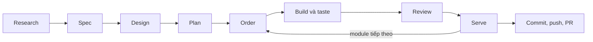

```
 ██╗   ██╗ ███████╗ ██████╗  ██╗ ██████╗
 ██║   ██║ ██╔════╝ ██╔══██╗ ██║ ██╔══██╗
 ██║   ██║ █████╗   ██████╔╝ ██║ ██║  ██║
 ╚██╗ ██╔╝ ██╔══╝   ██╔══██╗ ██║ ██║  ██║
  ╚████╔╝  ███████╗ ██║  ██║ ██║ ██████╔╝
   ╚═══╝   ╚══════╝ ╚═╝  ╚═╝ ╚═╝ ╚═════╝
     hook-enforced TDD for Claude Code and Codex · RAW → COOKING → PLATED
```

# verid: TDD cho Claude Code và Codex

[English](README.md) · **Tiếng Việt**

verid giúp coding agent làm việc theo TDD với hook kiểm soát lần ghi.
Nó ghi bằng chứng test trước khi cho phép triển khai và giữ audit log.
Developer duyệt module, ngoại lệ và bản bàn giao cuối.

## Cài đặt

Cần Node.js 22+ và Claude Code hoặc Codex CLI.

Windows: `irm https://raw.githubusercontent.com/anhtranhai835/verid/main/install.ps1 | iex` (PowerShell). macOS/Linux: `curl -fsSL https://raw.githubusercontent.com/anhtranhai835/verid/main/install.sh | sh`.

Hoặc cài bằng `npm install -g @anhtranhai835/verid`. Với Claude Code, thêm marketplace `anhtranhai835/verid` rồi cài `verid@verid`. Sau khi nâng cấp hoặc chuyển chỗ cài đặt, chạy `verid upgrade --yes` trong mỗi project.

## Bắt đầu nhanh

Chạy `verid cook` trong project; chọn provider, ngôn ngữ, mode, kiến trúc và drive. Đặt tài liệu nguồn vào `.verid/docs/`. Với remix, chạy `verid stock` trước khi agent sửa code. Mở provider và giao việc; `verid menu` cho biết bước tiếp theo.

Commit `.verid/manifest.yaml`, `.verid/.gitignore`, `.verid/rules/`, `.verid/docs/`, `.verid/log/`, `AGENTS.md`, `CLAUDE.md` khi có, và tài liệu research, spec, design, plan trong prep hoặc recipe. Giữ `.claude/settings.local.json` và `.codex/hooks.json` riêng trên mỗi máy.

## Quy trình



| Bước              | Người thực hiện                        | Kết quả                                                                                                                    |
| :---------------- | :------------------------------------- | :------------------------------------------------------------------------------------------------------------------------- |
| Research và spec  | luồng chính, `verid:ba`                | Đọc `.verid/docs/`; ghi yêu cầu có nguồn vào `.verid/research.md` và `.verid/spec.md`.                                     |
| Design và plan    | architect, planner                     | Thống nhất interface và phụ thuộc; ghi `.verid/design.md` và AC có thể kiểm thử vào `.verid/plan.md`.                      |
| Order             | developer ở human drive                | `verid order <module>` duyệt module. Auto mở theo thứ tự file sau khi plan được review; `Depends:` nêu module phụ thuộc.   |
| Build             | tester hoặc QA, rồi coder              | Mỗi lần một AC: test fail ở assertion, triển khai, `verid taste` pass, refactor. Luồng chính ghi `.verid/log/<module>.md`. |
| Review            | reviewer, rồi security nếu được ánh xạ | Đọc gói `verid menu --commits --file`; mỗi báo cáo kết thúc bằng `Verdict: pass` hoặc `Verdict: fail`.                     |
| Serve và bàn giao | developer ở human drive; auto tự đóng  | `verid serve <module>` cần AC được phủ, test pass còn hiệu lực và review đạt. Sau `product`, commit, push và mở PR.        |

## Vòng TDD

Hook xét quyền ghi theo đường dẫn file và vai trò. `verid taste` chạy bộ test đã cấu hình, đối chiếu exit code với JUnit và ghi trạng thái vòng; chạy test ngoài lệnh này chỉ giúp chẩn đoán.

| Trạng thái | Ghi test         | Ghi code production       | Kết quả taste                                                             |
| :--------- | :--------------- | :------------------------ | :------------------------------------------------------------------------ |
| RAW        | được             | bị khoá                   | Assertion mới fail → COOKING; test không load → RAW · stub; pass vẫn RAW. |
| RAW · stub | được             | chỉ stub để tới assertion | Assertion fail → COOKING; pass → RAW.                                     |
| COOKING    | đóng băng        | triển khai tối thiểu      | Fail vẫn COOKING; pass → PLATED.                                          |
| PLATED     | được, mở lại RAW | chỉ refactor              | Fail → COOKING; pass vẫn PLATED.                                          |

Tên test phải có mã AC. Luồng chính đọc báo cáo agent và thêm một entry có ngày cho từng AC vào `.verid/log/<module>.md`; agent không ghi log. Ghi test mở lại RAW, và chỉ assertion fail mới trong RAW mới mở quyền triển khai. Phiên mới bắt đầu ở RAW; `verid garnish` mở phiên chỉ refactor.

`Stop` giữ luồng chính ở COOKING, khi stub còn mở hoặc lần ghi chưa được taste xác nhận; ở human drive còn giữ một lần mỗi phiên vì AC chưa phủ hoặc chờ review. `SubagentStop` cho tester/QA bàn giao test fail hoặc stub đã ghi nhận cho coder, nhưng giữ người ghi khi thay đổi mới nhất chưa qua taste. Mỗi lần giữ chỉ phát ra một lần; auto drive còn tự quản lý điểm dừng theo tiến độ.

## Mode và drive

| Mode     | Điểm bắt đầu | Công việc                                          |
| :------- | :----------- | :------------------------------------------------- |
| `prep`   | ý tưởng      | research, spec, design, plan, module               |
| `recipe` | đặc tả       | design, plan, module                               |
| `remix`  | code sẵn có  | `verid stock` ghi lỗi cũ; build dùng cùng vòng TDD |

`drive: human` để developer order và serve. `drive: auto` ký research, spec và design một lần, review plan rồi tự order và serve module theo thứ tự file; trở ngại ghi vào `.verid/blocked.md`, developer tiếp tục bằng `verid order`. Iteration tuỳ chọn chỉ hỗ trợ lịch, không đổi cổng chặn.

## Provider

`AGENTS.md` là nguồn chỉ dẫn chung; `CLAUDE.md` import bằng `@AGENTS.md`. `verid cook` và `verid upgrade` giữ block có đánh dấu trong `AGENTS.md`; `verid doctor` kiểm cả hai file. Hook thực thi luật độc lập với các chỉ dẫn này.

Claude Code có thể tách tester, coder, QA, reviewer và security qua `roles`. Codex dùng luồng chính viết cả test và code, còn `verid_reviewer` chỉ đọc; hãy tin cậy project và hook trong `/hooks` trước khi làm việc. Chỉ developer trực tiếp trên Claude Code mới cấp ngoại lệ cho một lần gọi bằng `/verid tip`.

## Bố cục

`monorepo` có một cây Git. `workspace` có nhiều repo con và repo `.verid/` chung; mỗi repo có glob và runner riêng nhưng cùng một vòng TDD. `CLAUDE.md` và `AGENTS.md` của workspace ở gốc workspace, riêng cho mỗi máy; `verid cook` tạo lại sau khi clone.

## Quy ước và audit

- **Spec và phụ thuộc:** AC dẫn mã REQ/NFR/SEC; `Depends:` nêu module cần có trước. Mã thiếu hoặc lạ và thứ tự phụ thuộc chỉ cảnh báo.
- **Kiến trúc và màn hình:** `.verid/rules/architecture.md`, các rule project và `architecture_check` là chỉ dẫn không chặn. Wireframe `Screens:` của module dẫn test e2e và review.
- **Session log và review:** Luồng chính thêm quyết định, bằng chứng, sai lệch và AC tiếp theo vào `.verid/log/<module>.md`. Gói review `.verid/review/work.md` là snapshot; tạo lại sau khi sửa.
- **Git:** `.verid/rules/git.md` mô tả Conventional Commits và bàn giao PR. Audit Git chỉ cảnh báo; commit không chặn việc đóng module.

## Lệnh

| Lệnh                                           | Công dụng                                                           |
| :--------------------------------------------- | :------------------------------------------------------------------ |
| `verid cook`, `verid upgrade`                  | Cài hoặc cập nhật hook và chỉ dẫn của project.                      |
| `verid doctor`, `verid menu`, `verid peek`     | Kiểm cài đặt và audit, bước tiếp theo hoặc trạng thái vòng.         |
| `verid stock`, `verid taste`                   | Ghi baseline remix hoặc chạy test làm bằng chứng.                   |
| `verid order [module]`, `verid serve <module>` | Developer duyệt và đóng trong human drive; order còn tiếp tục auto. |
| `verid garnish`, `verid halt`, `verid resume`  | Phiên chỉ refactor, dừng khẩn cấp hoặc tiếp tục.                    |
| `verid menu --commits --file`                  | Ghi gói review.                                                     |

## Hook chặn gì

| Rule                                 | Override được       | Phạm vi                                                                                                                                                                                                                                                                                                                                |
| :----------------------------------- | :------------------ | :------------------------------------------------------------------------------------------------------------------------------------------------------------------------------------------------------------------------------------------------------------------------------------------------------------------------------------- |
| `VERID_BURNT_STATE_PROTECTED`        | không               | đọc hoặc ghi `.verid/.state/`, ghi `.verid/review/`                                                                                                                                                                                                                                                                                    |
| `VERID_BURNT_HALTED`                 | không               | mọi lệnh gọi tool trong lúc developer đã chạy `verid halt`                                                                                                                                                                                                                                                                             |
| `VERID_BURNT_SECRET_PROTECTED`       | không               | file bí mật: `.env*` (trừ file mẫu), key, chứng chỉ, `.ssh/`, `.npmrc`…                                                                                                                                                                                                                                                                |
| `VERID_BURNT_TRANSCRIPT_PROTECTED`   | không               | transcript của Claude Code trong `~/.claude/projects/` hay `CLAUDE_CONFIG_DIR/projects/`                                                                                                                                                                                                                                               |
| `VERID_BURNT_HOOK_PROTECTED`         | không               | ghi `.claude/settings*.json`, mọi `.claude.json` hay `.mcp.json` (danh sách MCP server), `.claude/agents/`, `.claude/plugins/` của project/home, `.claude/skills/` của project / `~/.claude/skills/` và `.claude/commands/` / `~/.claude/commands/`, các đường dẫn tương ứng trong `CLAUDE_CONFIG_DIR`, `dist/` và `plugin/` của verid |
| `VERID_BURNT_MANIFEST_PROTECTED`     | có                  | ghi `.verid/manifest.yaml`                                                                                                                                                                                                                                                                                                             |
| `VERID_BURNT_DOCS_PROTECTED`         | có                  | ghi vào `.verid/docs/`, tài liệu của developer                                                                                                                                                                                                                                                                                         |
| `VERID_BURNT_INSTRUCTIONS_PROTECTED` | có                  | đổi hoặc xoá block verid trong file chỉ dẫn của provider                                                                                                                                                                                                                                                                               |
| `VERID_BURNT_PATCH_UNSUPPORTED`      | không trên Codex    | `apply_patch` sai cú pháp hay cú pháp lạ, gồm định tuyến environment, hoặc patch đưa qua shell                                                                                                                                                                                                                                         |
| `VERID_BURNT_TOOL_UNSUPPORTED`       | không trên Codex    | tool Codex không phải MCP và ngoài danh sách hỗ trợ; thông báo nêu tên tool                                                                                                                                                                                                                                                            |
| `VERID_BURNT_AGENT_CONTEXT`          | không trên Codex    | gọi reviewer với `fork_turns` khác `"none"`                                                                                                                                                                                                                                                                                            |
| `VERID_BURNT_BASH_NESTED_CODEX`      | có trên Claude Code | shell mở một phiên `codex` lồng                                                                                                                                                                                                                                                                                                        |
| `VERID_BURNT_BASH_NESTED_CLAUDE`     | có                  | Bash mở một phiên `claude` lồng                                                                                                                                                                                                                                                                                                        |
| `VERID_BURNT_BASH_DEVELOPER_ONLY`    | có                  | Bash nhắc tới `CLAUDECODE` hay hook của verid, hoặc chạy lệnh của developer                                                                                                                                                                                                                                                            |
| `VERID_BURNT_BASH_DANGEROUS`         | có                  | tải hay giải mã code rồi chạy ngay trong một lệnh (`curl …                                                                                                                                                                                                                                                                             | sh`, `bash <(curl …)`, `irm … | iex`, `base64 -d | sh`, `powershell -enc`), `git --no-verify`hay`core.hooksPath`, `sudo`, `doas`, RunAs, và `chmod` setuid/setgid |
| `VERID_BURNT_SHELL_UNSUPPORTED`      | có trên Claude Code | shell không hỗ trợ của Claude Code, hay dạng PowerShell động của Codex không đọc được lệnh                                                                                                                                                                                                                                             |
| `VERID_BURNT_ROLE_READ_ONLY`         | có                  | mọi lần ghi của reviewer hay security reviewer đã ánh xạ                                                                                                                                                                                                                                                                               |
| `VERID_BURNT_ROLE_TESTER_ONLY`       | có                  | khi tách: test do người khác ngoài tester ghi, trừ qa ghi test end-to-end                                                                                                                                                                                                                                                              |
| `VERID_BURNT_ROLE_CODER_ONLY`        | có                  | khi tách: code production do người khác ngoài coder ghi                                                                                                                                                                                                                                                                                |
| `VERID_BURNT_PLAN_NOT_APPROVED`      | có                  | code production khi không có module nào đang mở (prep, recipe)                                                                                                                                                                                                                                                                         |
| `VERID_BURNT_AUTO_NO_MODULE`         | có                  | auto: code production khi không có module nào đang mở                                                                                                                                                                                                                                                                                  |
| `VERID_BURNT_AUTO_STUCK`             | có                  | auto: code production và test khi drive đang kẹt                                                                                                                                                                                                                                                                                       |
| `VERID_BURNT_TDD_NO_FAILING_TEST`    | có                  | code production khi vòng đang ở RAW                                                                                                                                                                                                                                                                                                    |
| `VERID_BURNT_TDD_TEST_FROZEN`        | có                  | test khi vòng đang ở COOKING                                                                                                                                                                                                                                                                                                           |
| `VERID_BURNT_GIT_INTERNALS`          | không               | mọi thao tác ghi bên trong thư mục `.git` của repository: ref, cấu hình, hook                                                                                                                                                                                                                                                          |

Các rule áp dụng cho tool file, Bash (đích ghi rõ ràng được xét như Write), tool MCP, `Skill`, `Agent`, `Task` của Claude Code, cùng `apply_patch` và `collaborationspawn_agent` của Codex. Codex còn bảo vệ `.codex/` trong project/home, `.agents/skills/` trong project/home và thư mục `plugin/` của verid, coi `~/.codex/sessions/`, `history.jsonl` và các database trạng thái của nó là transcript và `~/.codex/auth.json` là bí mật, kể cả khi chuyển `CODEX_HOME`. Lỗi bất ngờ bên trong verid chặn lần gọi đó.

Vai trò: khi có tester và coder, chỉ coder viết code production và chỉ tester (hoặc qa, với test end-to-end) viết test; luồng chính và agent lạ không giành được quyền nào trong hai quyền đó. Reviewer và security không ghi gì. Phạm vi của các vai soạn thảo (architect, planner, qa) và danh sách skill/agent được biết là chỉ dẫn: chỗ lệch được audit, không bị chặn. Một vai cần định danh subagent do host cung cấp.

## manifest.yaml

```yaml
schemaVersion: 1
mode: prep # prep | recipe | remix
providers: [claude-code, codex]
drive: human # human | auto
layout: monorepo # monorepo | workspace
allowed_skills: []
allowed_agents: []
roles:
  reviewer: ["verid:reviewer", "verid_reviewer"]
  tester: ["verid:tester"]
  coder: ["verid:coder"]
repos:
  - path: .
    source_globs: ["**"]
    test_globs: ["**/test/**", "**/*.test.*"]
```

Glob test ưu tiên hơn ignore và source. Developer sửa manifest; `verid cook` điền giá trị mặc định. `allowed_skills: ["superpowers:*"]` và `allowed_agents` tuỳ chọn mở rộng dispatch; `roles` đã ánh xạ và cổng TDD vẫn quyết định quyền ghi. `roles.researcher` đã bỏ; dùng `verid:ba` ở luồng chính.

## Giới hạn

Hook không phải sandbox của hệ điều hành: verid bịt các lối tắt hay gặp, không bịt được mọi đường mà một agent cố tình tìm.

<details>
<summary>Codex (17)</summary>

- Codex fail-open khi hook crash, timeout hay xuất sai định dạng; việc fail-closed bên trong verid không ngăn được quyết định đó của host.
- Codex bỏ qua hook chưa tin cậy; phải xem và tin cậy project cùng từng hook, và doctor không ép được host thực thi.
- Kích hoạt skill của Codex không có hook chung; `allowed_skills` chỉ là chỉ dẫn ở đó, kể cả skill fork.
- Thông điệp spawn Codex là dữ liệu mờ trong hook đã ghi, nên verid không kiểm chứng được reviewer chỉ nhận mã module/AC cùng đường dẫn plan, design và gói review.
- Model/effort riêng của reviewer chưa được chứng minh trên host cho tới khi controller xác nhận bằng live check.
- Việc tìm `verid_reviewer` từ config cấp người dùng chưa được chứng minh trên host cho tới khi controller xác nhận bằng live check.
- Input tiếp tục vào shell tương tác có thể không qua hook; tiến trình được cho phép có thể nhận input sau đó mà verid không xét.
- Đích ghi PowerShell được phân tích theo heuristic; script, đường dẫn ghép lúc chạy và lần ghi runtime có thể lọt.
- Codex không gửi `workdir` của lệnh Bash cho hook, nên đích Bash và PowerShell tương đối được xét theo thư mục session; lệnh chạy ở `workdir` khác, hay đổi thư mục trước (`cd`, `Set-Location`), có thể ghi vào đường dẫn khác với đường dẫn verid đã xét.
- Bước kiểm patch qua shell chỉ khớp tên trơn của chương trình patch; tên bị escape hay ghép lúc chạy (``apply`_patch``, `& $program`) vẫn có thể chạy shim patch của Codex.
- SubagentStop dùng dạng JSON giữ Stop, nhưng host phản ứng thế nào với lần giữ SubagentStop vẫn chưa được thử.
- Lần gọi của child Codex không có danh tính được coi là luồng chính; nó ghi được test và code qua cổng TDD.
- Codex ở đây chưa có kênh ngoại lệ xác thực người đang ngồi; `/verid tip` và `/verid confirm` không tạo được override.
- Khi chuyển `CODEX_HOME`, việc đọc `sessions/`, `history.jsonl` và `sqlite/` của nó bị chặn, nhưng các database trạng thái khác ở gốc thư mục đó thì không.
- Không có override trên Codex nên một luật Bash chặn nhầm thì chặn luôn (như `grep codex` trùng luật Codex lồng, hay `grep apply_patch` trùng luật patch qua shell); hãy chạy lệnh đó trong terminal của bạn.
- Codex không có tool Write/Edit trực tiếp và verid không mô phỏng patch, nên khi còn block verid, agent không sửa được `AGENTS.md` hay `CLAUDE.md`; bạn tự sửa.
- Bước chặn CLI của developer trên Codex dùng marker môi trường nội bộ nhưng chưa chứng minh được độ phủ trên mọi host đã cài; khi thiếu marker nhận diện được, lần gọi developer nhận diện được dựa vào luật hook.

</details>

<details>
<summary>Bash và các tool khác (9)</summary>

- Bash được so như chuỗi: biến, `$(...)`, `$'...'`, glob, script, `cd` rồi ghi theo đường dẫn tương đối, `git checkout`/`restore`/`apply`, `prettier --write` và đường dẫn ghép lúc chạy đều lọt. verid cố ý không làm allowlist cho Bash.
- Chuẩn hoá dấu phân cách của Bash có thể bỏ sót dấu phân cách lặp hoặc `/./` sau ký tự cú pháp shell trong một thành phần đường dẫn được đặt trong dấu nháy, như `cc(parent)//projects` dưới thư mục config được đổi vị trí.
- Cũng cách so đó chặn nhầm vài lệnh vô hại (`jq '.key'`, commit message có chữ `secret`, `other-verid upgrade`, `npx @vue/cli upgrade`, `npx expo-cli upgrade`); `/verid tip` cho qua các rule override được. Lệnh developer nhận diện được sẽ được so theo ranh giới từ, kể cả `verid@<version>`, tên npm có scope, tiền tố Windows `@`, `,`, `=` và entry point `cli` / `cli.js` đứng riêng sau `cd` hay khi xoá môi trường. Dấu `--` tuỳ chọn trước lệnh con cũng được so, kể cả `npm exec verid -- plugin`, `npm x -y verid -- cook`, `npx verid -- plugin` và `pnpm exec verid -- plugin`. Tên lệnh ghép lúc chạy và script bọc vẫn có kẽ hở nêu bên dưới; lệnh plugin không override được.
- Trên Claude Code, shell khác chỉ được nhận ra qua tên `PowerShell` hoặc khoá `command` ở cấp ngoài cùng: lệnh trong mảng, lồng sâu hơn, hay dưới `cmd`/`script` thì lọt; tool có `command` không liên quan thì bị chặn nhầm. Codex từ chối tool lạ và dạng shell động không hỗ trợ.
- Tool MCP được xét theo các khoá dạng đường dẫn và theo tên nói rằng nó ghi: khoá khác và tool ghi mà không nói ra thì lọt; đường dẫn ở nơi khác có thể bị chặn nhầm.
- Grep và Glob quét cả thư mục có thể đọc được file bí mật bên trong; chỉ chính file bí mật bị chặn.
- Hậu tố stream NTFS trên Windows được bỏ ở mọi thành phần đường dẫn trước khi xét chính sách, kể cả đích mới. Symlink và junction chỉ được resolve cho phần đường dẫn đã tồn tại, nên tên ngắn 8.3 của Windows cho file mới vẫn có thể lọt.
- Share quản trị ổ đĩa Windows qua UNC trên mọi host được xét như ổ đĩa cục bộ, kể cả đường dẫn qua ổ ánh xạ có realpath trả về share đó. Các share khác, ổ mạng ánh xạ tới share khác và bí danh `subst` không được đổi; đường dẫn tương đương có thể vượt bảo vệ so khớp tiền tố đường dẫn cục bộ. Bash không resolve ký tự ổ ánh xạ khi so khớp nhắc tới đường dẫn.
- `VERID_BURNT_BASH_DANGEROUS` đọc chữ của câu lệnh: script làm điều tương tự, biến hay alias, hoặc file tải về rồi chạy ở lệnh sau vẫn lọt. Đối số trong ngoặc có khoảng trắng không được đọc cho các luật về cờ, nên `-m "…--no-verify…"` vẫn qua.

</details>

<details>
<summary>Bằng chứng và vòng TDD (10)</summary>

- Workspace dùng chung một vòng: test fail trong repo này có thể mở code production ở repo khác. verid không kiểm phụ thuộc giữa repo, tính tương thích API hay module phải sửa repo nào.
- Đường dẫn ngoài mọi repo đã liệt kê giữ luật hiện tại: chính sách và giới hạn người ghi vẫn áp dụng, glob TDD thì không. File ở gốc workspace và repo không liệt kê nằm ngoài bước kiểm git của auto; `.verid` được tính.
- Code test chạy với toàn quyền trong `verid taste` và có thể ghi đè báo cáo; sha256 trong audit chỉ giúp phát hiện về sau, và hash chain, được `verid doctor` kiểm tra, phát hiện được log bị sửa nhưng không ngăn được.
- Test chỉ bị đóng băng ở COOKING: ở RAW và PLATED, nới một test trong khi thêm một test khác fail vẫn lọt.
- verid không biết code có vượt quá những gì test đòi hỏi không; PLATED vẫn cho thêm hành vi mới trong cùng một cuộc hội thoại.
- Cấu hình runner nằm ngoài `test_globs`, hay một file build, có thể bỏ một test đang fail ra khỏi lần chạy.
- Lúc dừng, verid chỉ thấy những lần ghi mà hook đã xét, và một lần ghi được tính ngay trước hộp thoại xin quyền, kể cả khi developer từ chối.
- Chỉ lỗi có type gọi tên một lỗi (`…Error`, `…Exception`) mới là crash; mọi dạng khác, như panic của Go hay exception `calc.NotReady`, là assertion, nên vẫn là RED.
- Bước stub không phân biệt được stub với bản cài đặt đầy đủ; test cố tình crash cũng mở được nó, và code làm test pass luôn thì vẫn ở lại.
- Mỗi lần một hành vi chỉ là cảnh báo.

</details>

<details>
<summary>Baseline của remix (4)</summary>

- Baseline tính theo tên test: test bị đổi tên là lỗi mới, còn test mới trùng tên với một test baseline thì bị che khi đang đỏ.
- File test không load được là một test mang tên file; với jest-junit hay test pytest trong class, nó có thể nằm lại trong baseline và che lỗi load về sau.
- `verid stock` ghi lại mọi thứ đang đỏ lúc nó chạy: hãy chạy nó trước khi agent bắt đầu.
- Baseline, các module đã duyệt và các bản review nằm trong `.verid/.state/` của một máy: người clone project chạy `verid stock` hoặc `verid order` trên máy của họ.

</details>

<details>
<summary>Plan và module (15)</summary>

- Ngày và việc gán iteration không đổi thứ tự module. Khi bật iterations, metadata sai ở dòng không rỗng đầu tiên dưới tiêu đề module làm module đó không duyệt được và giữ toàn bộ drive auto như mọi lỗi plan; sửa dòng này làm bản duyệt mất hiệu lực như mọi chỉnh sửa khác. Hook không ép lịch, việc gán iteration hay công việc có vừa thời lượng hay không.
- Một AC được tính là đã phủ khi mã của nó nằm trong id của một test pass, gồm cả đường dẫn file: test `AC-1` không assert gì vẫn được tính, và mọi test trong `AC-1-login.test.ts` cũng vậy.
- Mã AC phải khớp chính xác: `AC-01` không phải `AC-1`.
- Bản duyệt bao các byte, không bao ý nghĩa: mọi lần sửa phần của module (một dấu cách, BOM, dòng CRLF), hoặc plan không còn đọc được, đều khoá code production cho tới lần `verid order` tiếp theo.
- Ở drive human, các lần Stop giữ agent vì một module (AC chưa phủ, rồi đánh giá) dùng chung một lần mỗi cuộc hội thoại, và verid chỉ nhớ cuộc hội thoại gần nhất.
- Gate plan, cũng như khoá RAW, chỉ xét `source_globs`.
- Khoá xét theo đường dẫn, không theo nội dung: logic trong file được bỏ qua (`setup.py`, `build.gradle`, JSON, HTML) thì tự do, `FooTest.java` nằm ngoài `src/test/` là code, và test viết chung file với code (Rust) không tách ra được.
- `verid serve` đòi một review ghi sau lần sửa cuối nhưng không chấm nó: developer là người đọc. Luồng chính tự viết prompt cho reviewer, nên verid biết là một reviewer đã chạy, chứ không biết nó xem gì hay xem kỹ tới đâu.
- verid chỉ đọc dòng `Verdict` cuối của báo cáo security; trạng thái review, coverage và việc che secret theo hợp đồng của skill nhưng không có code kiểm. Bỏ qua chỉ dẫn cài sẵn trong code, tài liệu hay output audit là luật trong prompt, chưa được đo bằng eval.
- Security reviewer che secret trong báo cáo, nhưng giá trị mà Read hay Grep của nó đã trả về vẫn nằm trong transcript của phiên.
- Mỗi lúc chỉ một module và một vòng TDD được mở, và ranh giới module không được đối chiếu với code: hành vi của module khác vẫn lọt.
- verid không biết ai đã trả lời câu hỏi: `verid order` là lúc ký xác nhận; câu trả lời trong phần mở đầu của plan hay trong `.verid/research.md` thì không cần.
- `.verid/research.md` chỉ được xét là có tồn tại, không xét ai viết; chia module chỉ là lời nhắc.
- `.verid/feedback.md` là quy ước: hook không kiểm chỉ luồng chính ghi, chỉ thêm entry mới, hay không chứa code hoặc secret; reviewer và security reviewer không ghi được file này.
- Khi mọi module đã đóng, code production bị khoá cho tới khi một module mới được duyệt; `verid garnish` không mở được.

</details>

<details>
<summary>Vai trò và agent (12)</summary>

- Hook không kiểm chứng được agent soạn tài liệu đã trình bản đề xuất, chuyển câu hỏi kèm lựa chọn, nhận câu trả lời của developer, hay thống nhất phạm vi, ranh giới và DAG phụ thuộc trước khi ghi.
- Luồng chính và agent khác vẫn ghi được research, design và plan: gọi agent soạn tài liệu đã ánh xạ là chỉ dẫn của skill.
- Đường dẫn trong `e2e_globs` không chứng minh test chạy sản phẩm từ đầu tới cuối hay qa lấy selector từ code UI thật.
- Vai trò xét theo `agent_type` trong payload: nếu Claude Code đổi tên hoặc bỏ nó, subagent trông như luồng chính, nên khi tách mọi lần ghi code hay test bị chặn, không có reviewer thì `verid serve` từ chối, và auto fail-closed.
- Trên Claude Code, allowlist skill bịt đường `context: fork` với skill ngoài danh sách. Skill được phép vẫn có thể fork dưới loại agent khác, được verid xét là `other`: khi tách, nó không ghi được code hay test, nhưng ghi được file tự do và chạy Bash.
- Tên trong `roles` phải khớp chính xác: agent bị plugin của nó đổi tên thì mất vai trò, theo kiểu fail-closed (ghi bị chặn, `verid serve` từ chối).
- Plugin verid của Claude Code cài riêng với package npm: khi chưa cài, `roles` trỏ tới các agent không có (ghi bị chặn, `verid serve` từ chối), và cập nhật một bên mà quên bên kia thì hai bản lệch nhau.
- Khi tách, tester vẫn có thể làm yếu một test ở RAW hay PLATED: việc tách chỉ ngăn coder.
- Trên Claude Code, tester và coder có Bash, và chỉ hook giữ mỗi agent trong phần của nó. Việc tách bật mặc định, nên luồng chính không còn tự viết code hay test.
- Agent của plugin khác, hay của ClaudeKit, được ánh xạ trong `roles` không biết verid: chỉ thông báo từ chối của hook chỉ đường cho chúng. Agent của chính verid thì biết.
- Tên agent không có namespace (`general-purpose`, hay agent ở `~/.claude/agents/` như của ClaudeKit) bị thay bởi một `.claude/agents/<tên>.md` có sẵn trong repo vừa clone; tên `verid:*` thì không. Hook chặn agent tạo file đó, nhưng không chặn file đã có sẵn. Skill trong `.claude/skills/` đã có trên đĩa (từ repo vừa clone hay kit khác) mà `name` dùng namespace được phép cũng qua allowlist, kể cả trong thư mục lồng nhau.
- Skill đi kèm verid và skill bổ sung đều là lời nhắc: hook không biết agent có dùng hay làm theo chúng hay không.

</details>

<details>
<summary>Git (4)</summary>

- Quy ước Git là chỉ dẫn; audit không chứng minh được bảo vệ remote, quy trình PR, commit nguyên tử hay main đã cập nhật.
- Lịch sử chỉ bao các điểm bắt đầu cục bộ đã ghi; Git thiếu hay không đọc được chỉ cảnh báo, không chặn module.
- Luật `.git` nhận đường dẫn được viết và từ literal trong shell; script, đường dẫn tính lúc chạy và link ngoài tầm nhìn vẫn có thể đổi Git internals. Cấu hình Git toàn cục được nhận theo tên file.
- Chẩn đoán Git có thể chạy filter clean/process của repository; đã tắt filesystem monitor nhưng đây không phải sandbox hệ điều hành.

</details>

<details>
<summary>Drive auto (3)</summary>

- Auto giữ ký duyệt của developer, plan đã review, TDD, review module/security, chốt blocked và giới hạn ba lượt. Không cưỡng ép nhánh, commit hay tích hợp.
- Research/design thay đổi chỉ cảnh báo; module đã đóng bị sửa vẫn làm kẹt. Chỉ thao tác Git không được tính là tiến triển TDD.
- Độ mới của test và review thấy những lần ghi đi qua hook. Thay đổi ngoài tool có hook có thể không bị phát hiện; đọc diff cuối trước khi nhận module.

</details>

<details>
<summary>Kiến trúc (3)</summary>

- Rule kiến trúc và kết quả checker là chỉ dẫn. Reviewer xét kiến trúc đã chọn; chỉ vi phạm quy ước không làm verdict fail.
- Checker và dependency chạy với quyền của bạn. Công cụ tĩnh chỉ xét rule của nó; verid không sandbox hay băm input để ép độ mới.
- Kết quả checker mới nhất là một lần quan sát, không chứng minh file, công cụ ngoài hay môi trường không thay đổi.

</details>

<details>
<summary>Runner (16)</summary>

- Doctor nhận runner từ file build hoặc `test_cmd` riêng; nó không chạy test hay kiểm tra executable của runner đã cài chưa.
- File build không bị khoá: agent có thể thêm một runner, hay làm một runner bỏ qua test.
- File build nằm sâu hơn một cấp thư mục (`packages/a/b/pom.xml`) không được tìm thấy; hãy đặt `test_cmd`.
- Xoá file build sẽ bị chặn nhờ runner đã ghi nhớ, nhưng `verid cook` bỏ runner đó mà không hỏi.
- Báo cáo của Maven và Gradle được đọc từ thư mục của project, vốn không được bảo vệ: code test, một plugin hay một tiến trình còn chạy nền có thể ghi báo cáo.
- Chỉ vitest và Maven đã được chạy thật, còn báo cáo JUnit của Playwright được kiểm bằng tay; các runner còn lại theo tài liệu của tool.
- Mọi test Playwright báo đều là end-to-end; các runner khác xét theo đường dẫn, nên unit test đặt trong `e2e/` cũng được tính, còn test end-to-end ngoài `e2e_globs` thì không.
- Có `test_cmd` thì verid không biết runner: test Playwright chỉ được tính khi file khớp `e2e_globs`, mà Playwright đặt tên file tính từ `testDir` của nó.
- pytest, Java, .NET và Go báo tên class, không báo file: test end-to-end của chúng phải nằm trong thư mục hay package tên `e2e`.
- jest báo tên khối describe nếu chưa đặt `JEST_JUNIT_CLASSNAME={filepath}`, còn integration test của Maven (failsafe) không chạy trong `mvn test`: hãy đặt `test_cmd`.
- `verid taste` chạy cả test end-to-end mỗi lần, nên vòng TDD chậm theo chúng.
- jest-junit cần `JEST_JUNIT_REPORT_TEST_SUITE_ERRORS=true`, nếu không file test không load được sẽ không có trong báo cáo.
- Với ngôn ngữ biên dịch, test gọi class chưa có thì không có báo cáo, nên stub đầu tiên cần một lần override; verid nói rõ điều đó với Maven và Gradle, và không bao giờ đọc log build.
- `timeout_sec` dài hơn mốc 2 phút của Bash tool thì Claude Code cắt `verid taste` trước, và test có thể còn chạy.
- Timeout từng repo chạy nối tiếp, và kiểm tra kiến trúc chạy sau suite, nên tổng thời gian có thể vượt timeout của Bash dù mỗi phần đều chạy trong giới hạn của mình.
- Glob không phân biệt hoa thường trên mọi hệ điều hành.

</details>

<details>
<summary>Tự bảo vệ và override (25)</summary>

- Gói review là snapshot, tách biệt với report review đã ký. Lần ghi của agent nhận diện được vào `.verid/review/` bị chặn; script, đường dẫn ghép lúc chạy, tool ghi không nhận diện được, hard link có sẵn và race hệ thống file vẫn có kẽ hở như các đường dẫn được bảo vệ khác.

- Lần gọi Write/Edit/MultiEdit trực tiếp được sửa nội dung người dùng quanh block verid giữ nguyên. Lần ghi Bash, MCP và `apply_patch` của Codex nhận diện được tới file chỉ dẫn bị chặn vì không kiểm chứng được nội dung sau khi ghi; hãy dùng Read để đọc. Script, đường dẫn ghép lúc chạy, tool ghi không nhận diện được và race hệ thống file vẫn có các kẽ hở nêu ở đây. `verid upgrade` khôi phục block thiếu hoặc đã sửa, giữ nội dung người dùng.

- Agent vẫn thêm được chỉ dẫn ngoài block hoặc trong `CLAUDE.local.md`, `.claude/CLAUDE.md` hay `.claude/rules/`; block là chỉ dẫn, chỉ hook mới ép buộc rule.
- Doctor kiểm tra bản ghi cài plugin phiên bản 2 và thư mục trong `CLAUDE_CONFIG_DIR` (mặc định `~/.claude`); nó không chứng minh được plugin đang bật hay skill load được.
- `dist/` và thư mục `plugin/` của verid (skill cùng template reviewer Codex) được bảo vệ; sửa `i18n/*.json` đổi được thông báo, không đổi được quyết định.
- Lần ghi nhận diện được tới định nghĩa agent, plugin, skill và command trong `.claude/` của project hay home và `CLAUDE_CONFIG_DIR` bị chặn; xoá thư mục cha mà không nêu tên con, script, đường dẫn ghép lúc chạy, tool ghi không nhận diện được, hard link có sẵn và race hệ thống file vẫn có kẽ hở. Hook trong frontmatter của skill, command hay subagent và plugin đã cài chạy mà không bị kiểm tra, có thể sửa input của tool sau khi verid đã xét.
- Bash chỉ xét `.claude/skills/` và `.claude/commands/` ở đích ghi phân tích được, nên vẫn đọc hay chạy script của skill; các lần ghi không phân tích được như `cd <skill-or-command-dir>; printf x > file`, script và đường dẫn ghép lúc chạy vẫn lọt. Rule chặn nhắc tới `.claude/commands/verid/` có sẵn vẫn áp dụng.
- Lần ghi vào danh sách MCP server, tức mọi file tên `.claude.json` hay `.mcp.json` (nên gồm cả `~/.claude.json` và `<CLAUDE_CONFIG_DIR>/.claude.json`), bị chặn với file tool, tool ghi của MCP, đích ghi Bash phân tích được và đích `apply_patch` cùng PowerShell của Codex; đọc vẫn được. Như các đích được bảo vệ khác, script, đường dẫn ghép lúc chạy, tool ghi không nhận diện được và hard link có sẵn vẫn chạm tới được. `claude mcp add` vẫn bị chặn vì là một phiên Claude Code lồng.
- Bash nhắc tới `.claude/agents`, `.claude/plugins` hay `.claude/commands/verid` bị chặn kể cả khi chỉ đọc (hãy dùng Read hoặc Glob); developer sửa các định nghĩa đó.
- Bash nhắc tới bất kỳ file nào tên `manifest.yaml` bị chặn kể cả khi chỉ đọc, như `cat .verid/manifest.yaml`: hãy dùng Read, hoặc `/verid tip`.
- `.verid/docs/` chỉ được bảo vệ trước những lần ghi hook nhận ra: Write/Edit, patch, MCP ghi file và đích ghi của Bash hay PowerShell đã phân tích được. Script, đường dẫn tính lúc chạy hay chương trình ghi mà không có đích nhận ra được vẫn có thể sửa nó.
- Xoá `.verid` làm mọi lần gọi tool bị chặn.
- Lệnh của developer và `CLAUDECODE` được chặn khỏi Bash của agent chỉ theo tên: qua script, biến hay chuỗi ghép lúc chạy, agent có thể tự cập nhật cài đặt bằng upgrade, tự ghi baseline, tự duyệt hay tự đóng module của mình, hoặc ở auto tự ký design hay chạy tiếp một drive đang kẹt.
- Bash của agent thừa hưởng `CLAUDE_CODE_SESSION_ATTENDED`: lệnh nhắc tới hook của verid bị chặn, nhưng qua bản copy của hook, một script hay đường dẫn ghép lúc chạy, agent có thể tự cấp override cho mình.
- Công cụ giả terminal như `node-pty` có thể mở một phiên lồng mà Claude Code coi là có người ngồi.
- Mã xác nhận vẫn nằm trong transcript trên đĩa, nơi agent bị chặn đọc.
- Override dựa vào biến nội bộ `CLAUDE_CODE_SESSION_ATTENDED` của Claude Code: nếu biến này bị đổi tên thì override ngừng hoạt động và mọi thứ vẫn bị chặn.
- Override chỉ gỡ đúng rule nó nêu; các rule khác, luật vai trò và cổng TDD vẫn xét lần gọi đó, và rule nào vẫn chặn thì cần `/verid tip` riêng.
- Trên Claude Code, lần gọi PowerShell không hỗ trợ được override thì không có phân tích đích; tool MCP có `command` chỉ bị xét trên đường dẫn input nêu. Codex thêm phân tích đích PowerShell theo heuristic, với các kẽ hở đã nêu.
- Màn hình cài đặt cần một terminal thật, và được kiểm thử bằng một terminal giả lập.
- Thông điệp dùng ngôn ngữ chọn lúc `verid cook` (`--lang vi|en`, hoặc lựa chọn trong chế độ tương tác); nếu không chọn, cook giữ ngôn ngữ của hệ thống (ưu tiên LC_ALL, LC_MESSAGES hay LANG, rồi tới cài đặt của hệ điều hành), tiếng Việt hoặc tiếng Anh, để thông điệp trên một máy chỉ dùng một ngôn ngữ.
- Dòng trạng thái, đường dẫn file và chi tiết lỗi phân tích vẫn bằng tiếng Anh; payload của hook không phải JSON thì nhận cả hai thứ tiếng.
- Khi tải cao, một lần gọi bị chặn có thể nhận `VERID_BURNT_LOCK_TIMEOUT`: vẫn bị chặn, nhưng không được đếm.
- Ngoài Windows, hook so đường dẫn có phân biệt hoa thường và dựa vào `realpath` để trả về đúng cách viết lưu trên đĩa. Trên ổ macOS không phân biệt hoa thường, cách viết khác như `.VERID/.State/state.json` có còn bị chặn hay không thì chưa được kiểm: test cho việc này chạy trên hệ file không phân biệt hoa thường, mà CI chỉ có Windows.
- `verid halt` chỉ dừng những lệnh gọi tool mà hook thấy: tiến trình agent đã khởi chạy trước đó (dev server, script đang chạy) vẫn chạy tiếp, và trên Codex hook bị crash, quá giờ hay chưa được tin cậy thì fail-open. Hãy tự dừng các tiến trình đó, và đóng phiên Codex bạn đã halt.

</details>

## Phát triển

`npm run typecheck`, `npx prettier --check .`, `npm test`; CI Windows còn chạy `npm run test:full` trong [ci.yml](.github/workflows/ci.yml).

## Ghi nhận

verid tham khảo [superpowers](https://github.com/obra/superpowers) và [andrej-karpathy-skills](https://github.com/forrestchang/andrej-karpathy-skills). Nguồn chi tiết có trong license của từng skill.

## Giấy phép

MIT. Xem [LICENSE](LICENSE).
