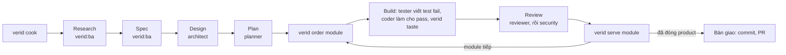

```
 ██╗   ██╗ ███████╗ ██████╗  ██╗ ██████╗
 ██║   ██║ ██╔════╝ ██╔══██╗ ██║ ██╔══██╗
 ██║   ██║ █████╗   ██████╔╝ ██║ ██║  ██║
 ╚██╗ ██╔╝ ██╔══╝   ██╔══██╗ ██║ ██║  ██║
  ╚████╔╝  ███████╗ ██║  ██║ ██║ ██████╔╝
   ╚═══╝   ╚══════╝ ╚═╝  ╚═╝ ╚═╝ ╚═════╝
     hook-enforced TDD for Claude Code and Codex · RAW → COOKING → PLATED
```

# verid: TDD cho Claude Code và Codex

[English](README.md) · **Tiếng Việt**

> Agent làm việc. verid kiểm chứng. Developer duyệt.

## Vì sao

Coding agent khi vội thường bỏ qua test: viết code trước, hoặc nới test cho tới khi nó xanh. Prompt chỉ yêu cầu được TDD; hook thì từ chối được lần ghi. verid giữ Claude Code và Codex đi đúng vòng RED → GREEN → REFACTOR, dưới tên RAW → COOKING → PLATED, và chỉ tính lần chạy test do chính nó thực hiện làm bằng chứng. verid luôn fail-closed, chỉ developer mở được ngoại lệ (chỉ trên Claude Code), và audit log có hash chain ghi lại điều đó. Giới hạn của host Codex nằm ở mục Giới hạn.

## Cài đặt

Yêu cầu: Node.js 22 trở lên, và [Claude Code](https://claude.com/claude-code) hoặc Codex CLI (đã thử với 0.164.0).

```powershell
# Windows (PowerShell 5.1+)
irm https://raw.githubusercontent.com/anhtranhai835/verid/main/install.ps1 | iex
```

```sh
# macOS / Linux
curl -fsSL https://raw.githubusercontent.com/anhtranhai835/verid/main/install.sh | sh
```

Installer kiểm Node 22+, cài verid bằng npm, thêm plugin verid khi có `claude` trên PATH, rồi hỏi thư mục project và chạy `verid cook` (chỉ khi có terminal và `CI` rỗng, `false` hay `0`; không bao giờ ở thư mục home). Ghim bản phát hành bằng `VERID_VERSION` (mặc định `latest`): `$env:VERID_VERSION = '1.1.0'` trước lệnh PowerShell (xoá bằng `Remove-Item Env:VERID_VERSION`), hoặc `... | VERID_VERSION=1.1.0 sh`.

Cài tay: `npm install -g @anhtranhai835/verid`, rồi với Claude Code:

```bash
claude plugin marketplace add anhtranhai835/verid
claude plugin install verid@verid
```

Claude Code chỉ cần plugin này: agent architect, planner, tester, coder, QA, reviewer, security và các skill BA, onboard, design, plan, build, TDD, debugging, review, security, edge-cases, problem-solving và predict. Từ bản clone: `npm ci`, `npm run build`, `npm link` (hoặc lệnh tương đương của `bun`). Hook trỏ tới `dist/` đã cài, nên hãy chạy `verid upgrade --yes` ở từng project sau khi nâng cấp, chuyển chỗ bản clone hay đổi giữa npm và bản clone.

Plugin còn kèm các tài liệu tham khảo chọn từ ClaudeKit: backend-development, frontend-development, databases, devops, mobile-development, web-testing, react-best-practices, mcp-builder, context-engineering, ui-ux-pro-max, security-scan và docs-seeker. Mỗi skill `verid:<tên>` có chỉ dẫn ngắn theo quy trình verid và tài liệu gốc trong thư mục riêng. Chỉ dùng skill phù hợp với project; chúng không đổi cổng duyệt module hay TDD.

Các agent phụ trợ chỉ đọc từ ClaudeKit gồm `verid:brainstormer`, `verid:technical-researcher`, `verid:code-simplifier`, `verid:docs-manager`, `verid:ui-ux-designer`, `verid:project-manager` và `verid:debugger`. Chúng tư vấn cho luồng chính, không nhận vai trò đã ánh xạ và không đổi cổng bằng chứng hay duyệt.

## Bắt đầu nhanh

Trong terminal của bạn, tại project cần giữ:

```bash
verid cook     # chọn provider, ngôn ngữ, mode, kiến trúc và, ở prep và recipe, drive
verid stock    # chỉ remix: ghi lại các test vốn đã fail
```

Mở provider và nói điều bạn muốn (với Codex, tin cậy hook trước, xem Provider và Codex). Mọi thông điệp của verid đều chỉ bước tiếp theo; `verid menu` cho biết project đang ở đâu.

Commit `.verid/manifest.yaml`, `.verid/.gitignore`, `.verid/rules/`, `.verid/docs/`, `.verid/log/`, file chỉ dẫn của provider (`CLAUDE.md` / `AGENTS.md`), `.claude/commands/verid/` khi dùng Claude Code và, ở prep và recipe, `.verid/research.md`, `.verid/spec.md`, `.verid/design.md` cùng `.verid/plan.md`. Giữ `.claude/settings.local.json` và `.codex/hooks.json` riêng trên máy: chúng ghi đường dẫn verid của máy bạn. `.verid/feedback.md`, nếu agent đã tạo, là log chỉ-thêm về chỗ vướng với chính verid (deny khó hiểu, skill mơ hồ, drive kẹt, cách làm tạm); bạn tự đọc và quyết định commit hay chia sẻ. Người trong team chạy `verid cook` một lần sau khi clone, rồi nhờ agent chạy `verid:onboard`: một bảng chỉ đọc về stack, lệnh test và glob của từng repo (kèm các dòng manifest nên sửa, để bạn tự sửa), một lần kiểm tra sức khoẻ và một bản tóm tắt ngắn project đang ở đâu.

## Quy trình làm việc với verid

verid chia việc giữa bạn (developer, trong terminal của bạn), luồng chính của agent và các agent được gán trong `roles`. Ở mọi bước, hook đứng giữa agent và file của bạn.



| Bước         | Ai                      | Việc gì xảy ra                                                                                                                                          |
| :----------- | :---------------------- | :------------------------------------------------------------------------------------------------------------------------------------------------------ |
| 1. Thiết lập | developer               | `verid cook` tạo `.verid/`, block chỉ dẫn và hook; remix thêm `verid stock`                                                                             |
| 2. Research  | luồng chính, `verid:ba` | đọc tài liệu của bạn trong `.verid/docs/`, hỏi bạn từng câu một và viết `.verid/research.md` (vấn đề, phạm vi, Glossary, Clarifications)                |
| 3. Spec      | luồng chính, `verid:ba` | viết `.verid/spec.md`: requirement REQ, NFR và SEC theo dạng EARS kèm nguồn, abuse case, phân loại dữ liệu và phần ngoài phạm vi; bạn thống nhất        |
| 4. Design    | architect               | chốt từng quyết định kiến trúc, kê code đã có, đề xuất ranh giới, module map kèm phụ thuộc và interface, thống nhất với bạn, viết `.verid/design.md`    |
| 5. Plan      | planner                 | chia việc thành module gồm các AC kiểm chứng được, ghi mã của spec (`- AC-1: … (REQ-1)`), `product` cuối cùng với AC end-to-end, trong `.verid/plan.md` |
| 6. Order     | developer               | `verid order <module>` duyệt một module: code production chỉ mở cho module đó                                                                           |
| 7. Build     | tester, coder           | với từng AC: tester viết test fail có mã AC trong tên, `verid taste` ghi lại lỗi (RAW → COOKING), coder làm cho pass (→ PLATED) rồi refactor            |
| 8. Review    | reviewer, security      | review chỉ đọc trên gói snapshot của module; mỗi báo cáo kết thúc bằng `Verdict: pass` hoặc `Verdict: fail`                                             |
| 9. Serve     | developer               | `verid serve <module>` đóng module khi mọi AC có test pass, lần chạy cuối còn mới và các review đã pass                                                 |
| 10. Bàn giao | luồng chính             | sau khi đóng `product`: commit, push và mở PR theo `.verid/rules/git.md`; bạn merge                                                                     |

- **remix** (đã có code và test) bỏ qua research, spec, design và plan: ghi baseline bằng `verid stock`, rồi build trong cùng vòng TDD.
- **drive auto** (prep và recipe): bạn ký research, spec (nếu có) và design một lần bằng `verid order`; sau đó verid tự review plan, order và đóng từng module, và chỉ dừng chờ bạn khi bị kẹt hay có câu hỏi cần bạn (`.verid/blocked.md`).
- **Codex** chỉ có một người viết: agent chính viết cả test lẫn code qua cùng cổng, và `verid_reviewer` chỉ đọc làm review.
- Khi có chỗ vướng với verid, agent ghi thêm vào `.verid/feedback.md`; bạn đọc nó.

## Vòng TDD

1. **Không có code production nếu chưa có test fail trước.** Code production bị khoá khi vòng ở RAW và, ở prep và recipe, khi chưa có module nào được duyệt. Khi một test đang fail, test bị đóng băng.
2. **Bằng chứng trước khi khẳng định.** Chỉ lần chạy `verid taste` có exit code khớp với báo cáo JUnit mới được tính. Ở drive human, agent không được dừng khi lần chạy cuối còn fail hay sau một thay đổi chưa lần chạy nào thấy; drive auto tự giữ mọi lần Stop.
3. **Chỉ developer mở ngoại lệ.** Trong Claude Code, `/verid tip` chỉ hoạt động khi có người ngồi ở bàn phím, không bao giờ từ subagent hay `claude -p`. Mỗi ngoại lệ cho một hành động vượt một rule, một lần. Codex không tạo được override.

| Trạng thái        | Code production  | Test            | `verid taste` fail                                                        | `verid taste` pass |
| :---------------- | :--------------- | :-------------- | :------------------------------------------------------------------------ | :----------------- |
| RAW (RED)         | bị khoá          | ghi được        | → COOKING nếu có lỗi assertion mới; → RAW · stub nếu test không load được | giữ RAW            |
| RAW · stub (RED)  | mở, chỉ cho stub | ghi được        | → COOKING nếu có lỗi assertion; giữ nguyên khi test vẫn không load được   | → RAW              |
| COOKING (GREEN)   | mở               | đóng băng       | giữ COOKING                                                               | → PLATED           |
| PLATED (REFACTOR) | mở               | ghi được, → RAW | → COOKING                                                                 | giữ PLATED         |

- Chỉ lỗi mà lần chạy trước chưa có mới đẩy vòng đi. Cuộc hội thoại mới bắt đầu từ RAW; `verid garnish` mở một cuộc hội thoại chỉ để refactor.
- Đặt mã AC vào tên của test phủ nó: `AC-1 adds two numbers`, hoặc `AC_1_addsTwoNumbers` khi tên không chứa được dấu gạch ngang.
- Ở remix, test trong baseline là lỗi có từ trước và đứng ngoài vòng; test nào pass thì rời baseline luôn.

## Mode và drive

| Mode     | Bắt đầu từ         | verid thêm                                                                       |
| :------- | :----------------- | :------------------------------------------------------------------------------- |
| `prep`   | ý tưởng, chưa code | research, design, rồi các module được duyệt, review và đóng, `product` cuối cùng |
| `recipe` | một bản đặc tả     | cùng các bước, với module lấy từ đặc tả                                          |
| `remix`  | đã có code và test | baseline gồm các test đã fail trước khi có verid                                 |

**Iterations** (tuỳ chọn, prep và recipe): `iterations` trong manifest chia plan theo các khoảng lịch. Trong `verid cook` tương tác, mỗi iteration kéo dài 14 ngày, nhấn Enter để lấy ngày bắt đầu là hôm nay, và demo vào ngày cuối; cờ CLI hoặc manifest vẫn cho phép đặt lịch khác. Một module có thể mở đầu bằng một dòng `Iteration: <n>` ngay sau tiêu đề; tắt iterations thì dòng này không được đọc. `verid menu` và lúc bắt đầu phiên cho biết iteration hiện tại, ngày của nó, số ngày tới ngày demo, số module đã đóng/tổng và module trễ. Iterations chỉ là định hướng: không đổi cổng hay thứ tự module.

**Drive.** `drive: human` (mặc định) để bạn duyệt và đóng module. `drive: auto` cần vai reviewer, tester và coder trên Claude Code (chỉ reviewer với project chỉ dùng Codex):

- Đóng module cần đúng bằng chứng như `verid serve`. Auto chạy có hay không có Git; nó không tạo nhánh, không đòi commit và không chờ merge.
- Ba lần fail review plan, module hay security, ba vòng coder fail trên một AC, hoặc các lần giữ Stop liên tiếp không tiến triển sẽ làm drive dừng. Chữ trong `.verid/blocked.md` được chốt vào state được bảo vệ, nên xoá file không làm drive chạy lại; sửa phần plan của module đã đóng cũng làm drive dừng.
- `verid order` cho chạy lại: đặt lại bộ đếm, xoá file blocked và xoá các review hiện có. `verid order <module>` và `verid serve` bị từ chối khi ở auto. Nhấn Esc để hỏi agent; lần Stop bình thường kế tiếp chạy tiếp.
- Hash research, spec hay design đổi chỉ cảnh báo, không khoá code; ký lại một spec đã đổi thì plan phải review lại.

## Provider và Codex

`providers` mặc định là `[claude-code]`. Chọn lúc `verid cook`, hoặc lặp `--provider` (`verid cook --provider claude-code --provider codex --mode prep --yes`); với project đã có, sửa `providers` trong manifest rồi chạy `verid upgrade --yes`.

Cook và upgrade chỉ đụng tới block giữa `<!-- verid:begin -->` và `<!-- verid:end -->` trong `CLAUDE.md` (Claude Code) và `AGENTS.md` (Codex); block đặt các luật cứng lên đầu, sau đó là chu trình TDD, quy trình, lệnh, state, allowlist khi manifest có thêm skill hay agent, và nhật ký feedback, mỗi phần một heading, và `verid doctor` báo khi block bị thiếu hay bị sửa. Không skill hay agent nào được chép vào project.

Với Codex, cook ghi `.codex/hooks.json` (PreToolUse, UserPromptSubmit, Stop, SubagentStop, SessionStart, có timeout) và ghép block có dấu `[agents.verid_reviewer]` vào `~/.codex/config.toml` (hoặc `$CODEX_HOME/config.toml`), giữ nguyên TOML còn lại. Sau đó mở Codex trong project, tin cậy project và tin cậy từng hook verid trong `/hooks`, rồi chạy `verid doctor`. Làm lại bước `/hooks` sau mỗi `verid upgrade --yes`. Thiết lập không bao giờ ghi lối vượt qua bước tin cậy.

Trên Codex:

- Agent chính viết cả test lẫn code dưới cùng cổng TDD; không tách tester/coder. Gọi `verid_reviewer` với `fork_turns: "none"`, mã module/AC và đường dẫn plan, design và gói review; thông điệp SubagentStop cuối của nó được ghi làm review.
- Từ chối dùng JSON với exit 0, giữ Stop dùng `decision: "block"`. PowerShell gắn nhãn `Bash` phải qua các rule Bash cộng kiểm đích ghi PowerShell; mọi đích của `apply_patch` phải qua rule đường dẫn, vai trò và TDD; patch đưa cho shell bị từ chối, vì hook không thấy thư mục làm việc của nó.
- Tool được hỗ trợ: `Bash`, `apply_patch`, `collaborationspawn_agent`, `collaborationwait_agent`, `update_plan`, `Read`, `Grep`, `Glob` và tool MCP (`mcp__*`). Tool khác, patch sai định dạng và dạng shell động không đọc được đều bị từ chối.
- Allowlist skill chỉ là chỉ dẫn và `/verid tip` không có tác dụng; dùng `verid peek` và `verid menu` trong terminal.

## Bố cục

`monorepo` (mặc định) là một cây project, đường dẫn repo tính từ gốc. `workspace` là thư mục không có `.git` riêng, chứa các repo riêng biệt:

```text
project/ (.git)              workspace/ (no .git)
├── api/                    ├── api/ (.git)
├── web/                    ├── web/ (.git)
├── .verid/                 ├── .verid/ (.git)
└── .claude/                └── .claude/ (per machine)
```

`CLAUDE.md` / `AGENTS.md` của workspace nằm tại gốc workspace, ngoài repo `.verid` dùng chung. Chúng thuộc mỗi máy; `verid cook` tạo lại block verid và giữ nội dung người dùng.

- **Nhận diện.** Cook chọn workspace khi thư mục nằm ngoài mọi git work tree (hoặc repo cha có gốc ở thư mục home, cho dotfile) và có ít nhất một repo con; `--layout monorepo|workspace` quyết định cho manifest mới, manifest đã có giữ bố cục của nó. Thiết lập workspace bị từ chối khi nằm trong một git repo khác. Home lấy từ `os.homedir()` của Node (`USERPROFILE` trên Windows).
- **Chia sẻ.** Cook biến `.verid/` thành git repo mà không commit, và ghi origin của từng repo con sau khi bỏ thông tin đăng nhập (chỉ giữ user SSH không mật khẩu `git@`); `default_branch` chỉ lấy từ `origin/HEAD` cục bộ. Người trong team clone nó thành `workspace/.verid` rồi chạy `verid cook` từ `workspace/`, lệnh này clone các repo còn thiếu (chỉ `https`, `ssh`, `git` và `file` cục bộ; share mạng và remote bắt đầu bằng `-` bị từ chối). Mở agent tại gốc workspace.
- **Clone.** Bản xem trước liệt kê mỗi clone dạng `path <- remote (branch)`; Git có thể hỏi và không có timeout. Cook giữ thư mục đã có, chạy tiếp sau lỗi và thoát mã 1 nếu có clone lỗi hay thiếu remote. Một dấu dưới `.verid/.state/clones/` theo dõi từng clone; thư mục có dấu được chấp nhận khi `HEAD` là một commit và index khớp với nó, nếu không thì đó là clone dở (kể cả do Ctrl-C): làm xong hay xoá nó rồi chạy lại. Repo chưa có commit vẫn hợp lệ.
- **Repo.** Glob và `verid taste` chạy theo từng repo, tất cả dùng chung một vòng TDD. qa ghi được `e2e_globs` của mọi repo; skill build dùng repo `role: frontend`, hoặc repo `role: e2e`. Audit Git xét mọi repo được liệt kê và `.verid`.

## Quy ước: kiến trúc và Git

Cook hỏi kiến trúc, `ddd` (mặc định), `clean`, `layered` hay `none` (`--architecture` khi không có terminal), và ghi các rule thuộc project: `.verid/rules/architecture.md`, `.verid/rules/git.md` và `.verid/rules/workflow.md`. Upgrade thêm file còn thiếu và giữ chỗ bạn đã sửa. Các quy ước này là chỉ dẫn, không chặn: verid báo chỗ lệch và không bao giờ chặn tool, order, `serve` hay auto vì chúng.

- **Kiến trúc.** Architect điều chỉnh `.verid/design.md` theo profile đã chọn; reviewer kiểm nó. Mỗi repo có thể đặt `architecture_check` (`command`, `inputs`, `timeout_sec` tuỳ chọn); sau khi bộ test pass, `verid taste` chạy nó và ghi kết quả. Checker fail, thiếu hay chưa chạy chỉ cảnh báo.
- **Màn hình.** Module làm thay đổi giao diện người dùng có khối `Screens:` trong `.verid/plan.md`: verid:plan vẽ 2–3 wireframe ASCII cho mỗi màn hình thay đổi, bạn chọn một, và module giữ lại wireframe đã chọn cùng các trạng thái của nó, nên order module cũng là duyệt màn hình. Test e2e kiểm tra phần tử và nhãn của wireframe đã chọn, và reviewer so code UI với nó.
- **Session log.** Sau mỗi AC, luồng chính ghi thêm một mục có ngày vào `.verid/log/<module>.md`: cái gì đã pass, quyết định và lý do, chỗ lệch kế hoạch, commit và việc tiếp theo. Khi mở phiên, clear, compact và resume, verid chỉ tới log của module đang mở, để cuộc hội thoại mới nối tiếp chỗ phiên trước dừng. Log là chỉ dẫn; không có gì kiểm tra nó.
- **Phụ thuộc.** Một module có thể ghi các module nó dựa vào bằng dòng `Depends: api, auth` trước AC đầu tiên, và các module đó nằm phía trên nó trong plan. `verid menu` hiện `waits for …` và chỉ gợi ý order module khi các module đó đã serve; `verid doctor` cảnh báo `DEPENDS` khi tên không có, là chính nó hoặc nằm phía sau, và `verid order` một module khi phụ thuộc chưa serve thì báo ra và ghi `ORDER_DEPENDS`. Không có gì ở đây chặn; drive auto mở module theo thứ tự trong file.
- **Spec.** `.verid/spec.md` chứa requirement REQ, NFR và SEC; mỗi AC ghi mã nó chứng minh, ví dụ `- AC-1: cộng hai số (REQ-1)`, và một dòng `Review Focus:` có thể nói vì sao một mã không có AC. `verid menu` đếm và `verid doctor` liệt kê `SPEC_UNCOVERED` (requirement còn hiệu lực mà không AC hay dòng Review Focus nào ghi) và `SPEC_UNKNOWN` (mã được ghi mà spec không có hoặc đã bỏ). Hai cảnh báo này không chặn; `[NEEDS CLARIFICATION: …]` trong spec là câu hỏi mở như trong plan.
- **Git.** `.verid/rules/git.md` mô tả Conventional Commits, mỗi commit một thay đổi trọn vẹn, nhánh `feat/`, `fix/`, `chore/`, `docs/`, `refactor/` hay `test/`, mỗi nhánh một PR, squash-merge và xoá nhánh đã merge. `verid menu`, `serve`, Stop của auto và `doctor` cảnh báo khi ở main hay nhánh sai tên, có thay đổi chưa commit, message sai hay không đọc được lịch sử. Tự bật branch protection và chỉ cho squash-merge trên GitHub; verid chạy offline.
- **Gói review.** `verid menu --commits` cho thấy lịch sử và diff của module đang mở, không có file bí mật hay state được bảo vệ; `--file` ghi nó vào `.verid/review/work.md` và chỉ in đường dẫn. Reviewer nhận đường dẫn đó, mã module/AC và đường dẫn plan/design, rồi tự đọc file. Agent đọc được gói nhưng không ghi được; tạo lại sau khi sửa.
- **Mất hiệu lực.** Ghi code hay test sau đó mà hook thấy, hoặc một lần order mới, làm mất review của module; mọi lần ghi trong project ngoài `.verid/` làm mất security review. Chỉ commit thì không. Hook vẫn chặn ghi vào nội bộ Git.

## Các lệnh

| Lệnh                                | Ai                           | Làm gì                                                                                                                                               |
| :---------------------------------- | :--------------------------- | :--------------------------------------------------------------------------------------------------------------------------------------------------- |
| `verid cook [--dry-run] [--yes]`    | developer                    | thiết lập cho project và máy này; đề xuất mặc định mới cho manifest cũ                                                                               |
| `verid upgrade [--dry-run] [--yes]` | developer                    | thêm mặc định còn thiếu vào manifest, tạo lại lệnh của verid và cập nhật đường dẫn hook của máy này                                                  |
| `verid doctor`                      | mọi người                    | kiểm offline, chỉ đọc: Node, repo, Git, runner, hook, block chỉ dẫn, plugin, agent của các vai và hash chain của audit log; thoát mã 1 khi có vấn đề |
| `verid taste`                       | agent                        | chạy test, rồi sau khi bộ test pass thì chạy từng architecture check đã cấu hình; chỉ những lần chạy này được tính là bằng chứng                     |
| `verid peek`                        | mọi người                    | vòng TDD, bước tiếp, và vì sao lần chạy trước không được tính                                                                                        |
| `verid menu [--commits [--file]]`   | mọi người                    | research, module và độ phủ AC, câu hỏi còn mở, audit và bước tiếp; `--commits` thêm lịch sử và diff của module đang mở                               |
| `verid stock`                       | developer                    | remix: ghi các test đang fail làm baseline                                                                                                           |
| `verid order [module]`              | developer                    | human: duyệt một module của `.verid/plan.md`, ký luôn `.verid/design.md`; auto: ký research, spec và design, hoặc chạy lại sau khi dừng              |
| `verid serve <module>`              | developer                    | drive human: đóng module đang mở khi mọi AC pass, lần chạy cuối còn mới và các review (cùng security, khi có) đã pass                                |
| `verid garnish`                     | developer                    | mở code production cho một cuộc hội thoại chỉ để refactor                                                                                            |
| `verid halt [lý do]`                | developer                    | kill switch: từ chối mọi lệnh gọi tool của agent, kể cả qua `/verid tip`, và không giữ Stop nào, tới khi `verid resume`                              |
| `verid resume`                      | developer                    | gỡ `verid halt`                                                                                                                                      |
| `/verid:tip <lý do>`                | developer, trong Claude Code | xin cho hành động vừa bị chặn đi qua, kèm mã dùng một lần                                                                                            |
| `/verid:confirm <mã>`               | developer, trong Claude Code | cho đúng hành động đó đi qua một lần                                                                                                                 |
| `/verid:peek`, `/verid:menu`        | developer, trong Claude Code | những gì `verid peek` và `verid menu` hiển thị, chỉ cho bạn xem                                                                                      |

- `verid cook` nhận `--provider claude-code|codex` lặp được, `--mode prep|recipe|remix`, `--drive human|auto`, `--layout monorepo|workspace`, `--architecture`, `--lang vi|en`, `--test-cmd`, `--src`/`--tests` lặp được, và ở prep hay recipe `--iterations --duration "2 weeks" --start-date 2026-10-12 --demo-day Friday` (đủ cả ba). Khi đã có manifest, các cờ này bị bỏ qua kèm ghi chú: hãy sửa `.verid/manifest.yaml`.
- Cook và upgrade hiện cây file trước khi ghi (`+` tạo, `~` sửa, `=` giữ, `!` lưu ý) và hỏi `Apply? (Y/n)`; nếu file đổi trong lúc chờ, chúng hiện plan mới và hỏi lại. `--dry-run` không ghi gì; `--yes` nhận mặc định, kể cả mode được gợi ý (prep, hoặc remix khi có `src/`, `lib/` hay `app/`). Không có terminal thì cook cần mode chỉ rõ hoặc manifest đã có, còn upgrade cần `--yes`. Upgrade ghi đè chỗ sửa cục bộ ở bốn lệnh được tạo; cook giữ chúng.
- Các lệnh của developer từ chối chạy trong Claude Code và trong shell Codex nhận ra được, và hook chặn các lời gọi lệnh developer nhận ra được.

## Hook chặn gì

| Rule                                 | Override được       | Phạm vi                                                                                                                                                                                                                                                                                                                                |
| :----------------------------------- | :------------------ | :------------------------------------------------------------------------------------------------------------------------------------------------------------------------------------------------------------------------------------------------------------------------------------------------------------------------------------- |
| `VERID_BURNT_STATE_PROTECTED`        | không               | đọc hoặc ghi `.verid/.state/`, ghi `.verid/review/`                                                                                                                                                                                                                                                                                    |
| `VERID_BURNT_HALTED`                 | không               | mọi lệnh gọi tool trong lúc developer đã chạy `verid halt`                                                                                                                                                                                                                                                                             |
| `VERID_BURNT_SECRET_PROTECTED`       | không               | file bí mật: `.env*` (trừ file mẫu), key, chứng chỉ, `.ssh/`, `.npmrc`…                                                                                                                                                                                                                                                                |
| `VERID_BURNT_TRANSCRIPT_PROTECTED`   | không               | transcript của Claude Code trong `~/.claude/projects/` hay `CLAUDE_CONFIG_DIR/projects/`                                                                                                                                                                                                                                               |
| `VERID_BURNT_HOOK_PROTECTED`         | không               | ghi `.claude/settings*.json`, mọi `.claude.json` hay `.mcp.json` (danh sách MCP server), `.claude/agents/`, `.claude/plugins/` của project/home, `.claude/skills/` của project / `~/.claude/skills/` và `.claude/commands/` / `~/.claude/commands/`, các đường dẫn tương ứng trong `CLAUDE_CONFIG_DIR`, `dist/` và `plugin/` của verid |
| `VERID_BURNT_MANIFEST_PROTECTED`     | có                  | ghi `.verid/manifest.yaml`                                                                                                                                                                                                                                                                                                             |
| `VERID_BURNT_DOCS_PROTECTED`         | có                  | ghi vào `.verid/docs/`, tài liệu của developer                                                                                                                                                                                                                                                                                         |
| `VERID_BURNT_INSTRUCTIONS_PROTECTED` | có                  | đổi hoặc xoá block verid trong file chỉ dẫn của provider                                                                                                                                                                                                                                                                               |
| `VERID_BURNT_PATCH_UNSUPPORTED`      | không trên Codex    | `apply_patch` sai cú pháp hay cú pháp lạ, gồm định tuyến environment, hoặc patch đưa qua shell                                                                                                                                                                                                                                         |
| `VERID_BURNT_TOOL_UNSUPPORTED`       | không trên Codex    | tool Codex không phải MCP và ngoài danh sách hỗ trợ; thông báo nêu tên tool                                                                                                                                                                                                                                                            |
| `VERID_BURNT_AGENT_CONTEXT`          | không trên Codex    | gọi reviewer với `fork_turns` khác `"none"`                                                                                                                                                                                                                                                                                            |
| `VERID_BURNT_BASH_NESTED_CODEX`      | có trên Claude Code | shell mở một phiên `codex` lồng                                                                                                                                                                                                                                                                                                        |
| `VERID_BURNT_BASH_NESTED_CLAUDE`     | có                  | Bash mở một phiên `claude` lồng                                                                                                                                                                                                                                                                                                        |
| `VERID_BURNT_BASH_DEVELOPER_ONLY`    | có                  | Bash nhắc tới `CLAUDECODE` hay hook của verid, hoặc chạy lệnh của developer                                                                                                                                                                                                                                                            |
| `VERID_BURNT_BASH_DANGEROUS`         | có                  | tải hay giải mã code rồi chạy ngay trong một lệnh (`curl …                                                                                                                                                                                                                                                                             | sh`, `bash <(curl …)`, `irm … | iex`, `base64 -d | sh`, `powershell -enc`), `git --no-verify`hay`core.hooksPath`, `sudo`, `doas`, RunAs, và `chmod` setuid/setgid |
| `VERID_BURNT_SHELL_UNSUPPORTED`      | có trên Claude Code | shell không hỗ trợ của Claude Code, hay dạng PowerShell động của Codex không đọc được lệnh                                                                                                                                                                                                                                             |
| `VERID_BURNT_ROLE_READ_ONLY`         | có                  | mọi lần ghi của reviewer hay security reviewer đã ánh xạ                                                                                                                                                                                                                                                                               |
| `VERID_BURNT_ROLE_TESTER_ONLY`       | có                  | khi tách: test do người khác ngoài tester ghi, trừ qa ghi test end-to-end                                                                                                                                                                                                                                                              |
| `VERID_BURNT_ROLE_CODER_ONLY`        | có                  | khi tách: code production do người khác ngoài coder ghi                                                                                                                                                                                                                                                                                |
| `VERID_BURNT_PLAN_NOT_APPROVED`      | có                  | code production khi không có module nào đang mở (prep, recipe)                                                                                                                                                                                                                                                                         |
| `VERID_BURNT_AUTO_NO_MODULE`         | có                  | auto: code production khi không có module nào đang mở                                                                                                                                                                                                                                                                                  |
| `VERID_BURNT_AUTO_STUCK`             | có                  | auto: code production và test khi drive đang kẹt                                                                                                                                                                                                                                                                                       |
| `VERID_BURNT_TDD_NO_FAILING_TEST`    | có                  | code production khi vòng đang ở RAW                                                                                                                                                                                                                                                                                                    |
| `VERID_BURNT_TDD_TEST_FROZEN`        | có                  | test khi vòng đang ở COOKING                                                                                                                                                                                                                                                                                                           |
| `VERID_BURNT_GIT_INTERNALS`          | không               | mọi thao tác ghi bên trong thư mục `.git` của repository: ref, cấu hình, hook                                                                                                                                                                                                                                                          |

Các rule áp dụng cho tool file, Bash (đích ghi rõ ràng được xét như Write), tool MCP, `Skill`, `Agent`, `Task` của Claude Code, cùng `apply_patch` và `collaborationspawn_agent` của Codex. Codex còn bảo vệ `.codex/` trong project/home, `.agents/skills/` trong project/home và thư mục `plugin/` của verid, coi `~/.codex/sessions/`, `history.jsonl` và các database trạng thái của nó là transcript và `~/.codex/auth.json` là bí mật, kể cả khi chuyển `CODEX_HOME`. Lỗi bất ngờ bên trong verid chặn lần gọi đó.

Vai trò: khi có tester và coder, chỉ coder viết code production và chỉ tester (hoặc qa, với test end-to-end) viết test; luồng chính và agent lạ không giành được quyền nào trong hai quyền đó. Reviewer và security không ghi gì. Phạm vi của các vai soạn thảo (architect, planner, qa) và danh sách skill/agent được biết là chỉ dẫn: chỗ lệch được audit, không bị chặn. Một vai cần định danh subagent do host cung cấp.

## manifest.yaml

```yaml
schemaVersion: 1
mode: remix # prep | recipe | remix
providers: [claude-code] # tuỳ chọn: claude-code, codex; mặc định [claude-code]
architecture: ddd # ddd | clean | layered | none
allowed_skills: [] # tuỳ chọn, bổ sung: tên chính xác hoặc prefix:*
allowed_agents: [] # thêm agent type chính xác; roles đã được biết
roles: # tuỳ chọn: agent type, đúng như host báo, cho từng vai trò
  reviewer: ["verid:reviewer"]
  tester: ["verid:tester"] # có cả tester lẫn coder thì việc được tách
  coder: ["verid:coder"]
  architect: ["verid:architect"] # tuỳ chọn: chỉ .verid/design.md
  planner: ["verid:planner"] # tuỳ chọn: chỉ .verid/plan.md
  qa: ["verid:qa"] # tuỳ chọn: chỉ test end-to-end
  security: ["verid:security"] # tuỳ chọn: module chỉ đóng khi có Verdict: pass của nó
drive: human # human | auto
layout: monorepo # monorepo | workspace; thiếu thì mặc định monorepo
# iterations: { duration: "2 weeks", start_date: "2026-10-12", demo_day: Friday } # chỉ prep, recipe
# git: { default_branch: main, protected_refs: ["refs/heads/release"] } # tuỳ chọn, cho audit Git
repos:
  - path: .
    # remote: https://example.com/team/api.git  # tuỳ chọn: clone repo còn thiếu
    # default_branch: main  # tuỳ chọn: main của repo này cho audit Git
    # role: backend  # tuỳ chọn: frontend | backend | e2e | other
    # test_cmd: make test JUNIT={junit}   # tuỳ chọn: không có thì verid tự tìm runner
    source_globs: ["**"] # code production
    test_globs: ["**/test/**", "**/*.test.*", …] # test và cấu hình runner
    ignore_globs: ["**/*.md", "**/*.json", …] # không bao giờ là code production
    e2e_globs: ["**/e2e/**", "**/*.e2e.*"] # test end-to-end
    timeout_sec: 100 # tuỳ chọn
    # architecture_check: { command: "npm run architecture", inputs: [".dependency-cruiser.cjs"] } # tuỳ chọn
```

- Chỉ developer sửa manifest. `verid cook` ghi các mặc định, trong đó mọi file đều là code, trừ test, tài liệu, dữ liệu, cấu hình, file build và thư mục của tool.
- Đường dẫn khớp `test_globs` hay `e2e_globs` là test; nếu không, khớp `ignore_globs` thì tự do; nếu không nữa, khớp `source_globs` là code. Glob hỗ trợ `**`, `*`, `?`; một thư mục được viết là `src/**`. Một AC viết `- AC-3 (e2e): …` cần một test end-to-end pass: test bất kỳ do Playwright báo, hoặc test của runner khác mà file khớp `e2e_globs`.
- `providers` là danh sách không rỗng gồm `claude-code` và/hoặc `codex`. Skill được biết mặc định là `verid:*`; `allowed_skills` thêm tên chính xác (`team:lint`) hay namespace (`team:*`). Dispatch agent biết các agent phụ trợ chỉ đọc đi kèm, các type trong `roles` và `allowed_agents`. Dispatch ngoài các danh sách này được audit; nó không bao giờ cho agent một vai hay vượt rule ghi.
- Muốn dùng superpowers tuỳ chọn thì tự cài và thêm `allowed_skills: ["superpowers:*"]`; `roles` đã gán và cổng TDD vẫn áp dụng, còn type agent khác thì thêm tường minh vào `allowed_agents`.
- Mỗi tên trong `roles` chỉ thuộc một vai trò, và trên Claude Code đã có tester thì phải có coder. Không có `roles` thì không ai bị giữ theo vai trò, và `verid serve` từ chối vì thiếu reviewer. Cook đề xuất các vai tuỳ chọn còn thiếu cho mapping cũ, thêm `verid_reviewer` vào `roles.reviewer` khi chọn Codex, và giữ tên bạn đặt. Project chỉ dùng Codex không gán `security`: reviewer duy nhất của nó kiểm luôn security bằng `verid:security`.
- Trường cũ `roles.researcher` bị từ chối kèm hướng dẫn sửa: xoá nó, chạy `verid cook`, rồi dùng `verid:ba` ở luồng chính.
- `iterations`: `duration` là số nguyên dương cộng `day(s)` hay `week(s)`, `start_date` là ngày thật dạng `YYYY-MM-DD`, `demo_day` từ `Monday` đến `Sunday` (phân biệt hoa thường).
- Đường dẫn repo là tương đối, riêng biệt và không lồng nhau (`./x`, `x/` và dấu phân cách lặp được chuẩn hoá); đường dẫn tuyệt đối, đi lên thư mục cha, alias Windows và repo workspace qua link bị từ chối. Mỗi repo có glob, lệnh và timeout riêng; `remote`, `default_branch` và `role` là tuỳ chọn.

Không có `test_cmd` thì verid tìm runner từ các file build ở gốc repo và các thư mục cấp một:

| File build                                     | verid chạy                                   | Không có báo cáo thì agent chạy                             |
| :--------------------------------------------- | :------------------------------------------- | :---------------------------------------------------------- |
| `package.json` có vitest, hoặc jest            | `npx --no vitest run` / `npx --no jest --ci` | `npm install` / `npm install -D jest-junit`                 |
| `playwright.config.*`, hoặc `@playwright/test` | `npx --no playwright test`                   | `npm install -D @playwright/test && npx playwright install` |
| `pytest.ini`, `conftest.py`, `pyproject.toml`  | `python -m pytest`                           | `python -m pip install pytest`                              |
| `pom.xml`, `build.gradle(.kts)`                | `mvn -B -ntp test`, `gradlew test --rerun`   | —                                                           |
| `*.sln`, `*.csproj`                            | `dotnet test`                                | `dotnet add <project> package JunitXml.TestLogger`          |
| `go.mod`                                       | `gotestsum ./...`                            | `go install gotest.tools/gotestsum@latest`                  |
| `phpunit.xml`, phpunit trong `composer.json`   | `php vendor/bin/phpunit`                     | `composer require --dev phpunit/phpunit`                    |
| `.rspec`, rspec trong `Gemfile`                | `bundle exec rspec`                          | `bundle add rspec_junit_formatter --group test`             |

- Playwright chạy cạnh vitest hay jest thì mặc định mỗi bên lấy cả file của bên kia: đặt `testDir: "e2e"` trong playwright.config và loại `e2e/**` trong config của vitest hay jest (`verid cook` nhắc điều này khi thấy cả hai).
- Rust và CMake không có cờ ghi báo cáo: hãy đặt `test_cmd`. Không có runner nào thì `verid taste` từ chối (`VERID_BURNT_RUN_NO_RUNNER`), và cũng từ chối khi runner đã từng chạy giờ không còn (`VERID_BURNT_RUN_RUNNER_GONE`), cho tới khi chạy lại `verid cook`.

## Giới hạn

Hook không phải sandbox của hệ điều hành: verid bịt các lối tắt hay gặp, không bịt được mọi đường mà một agent cố tình tìm.

<details>
<summary>Codex (17)</summary>

- Codex fail-open khi hook crash, timeout hay xuất sai định dạng; việc fail-closed bên trong verid không ngăn được quyết định đó của host.
- Codex bỏ qua hook chưa tin cậy; phải xem và tin cậy project cùng từng hook, và doctor không ép được host thực thi.
- Kích hoạt skill của Codex không có hook chung; `allowed_skills` chỉ là chỉ dẫn ở đó, kể cả skill fork.
- Thông điệp spawn Codex là dữ liệu mờ trong hook đã ghi, nên verid không kiểm chứng được reviewer chỉ nhận mã module/AC cùng đường dẫn plan, design và gói review.
- Model/effort riêng của reviewer chưa được chứng minh trên host cho tới khi controller xác nhận bằng live check.
- Việc tìm `verid_reviewer` từ config cấp người dùng chưa được chứng minh trên host cho tới khi controller xác nhận bằng live check.
- Input tiếp tục vào shell tương tác có thể không qua hook; tiến trình được cho phép có thể nhận input sau đó mà verid không xét.
- Đích ghi PowerShell được phân tích theo heuristic; script, đường dẫn ghép lúc chạy và lần ghi runtime có thể lọt.
- Codex không gửi `workdir` của lệnh Bash cho hook, nên đích Bash và PowerShell tương đối được xét theo thư mục session; lệnh chạy ở `workdir` khác, hay đổi thư mục trước (`cd`, `Set-Location`), có thể ghi vào đường dẫn khác với đường dẫn verid đã xét.
- Bước kiểm patch qua shell chỉ khớp tên trơn của chương trình patch; tên bị escape hay ghép lúc chạy (``apply`_patch``, `& $program`) vẫn có thể chạy shim patch của Codex.
- SubagentStop dùng dạng JSON giữ Stop, nhưng host phản ứng thế nào với lần giữ SubagentStop vẫn chưa được thử.
- Lần gọi của child Codex không có danh tính được coi là luồng chính; nó ghi được test và code qua cổng TDD.
- Codex ở đây chưa có kênh ngoại lệ xác thực người đang ngồi; `/verid tip` và `/verid confirm` không tạo được override.
- Khi chuyển `CODEX_HOME`, việc đọc `sessions/`, `history.jsonl` và `sqlite/` của nó bị chặn, nhưng các database trạng thái khác ở gốc thư mục đó thì không.
- Không có override trên Codex nên một luật Bash chặn nhầm thì chặn luôn (như `grep codex` trùng luật Codex lồng, hay `grep apply_patch` trùng luật patch qua shell); hãy chạy lệnh đó trong terminal của bạn.
- Codex không có tool Write/Edit trực tiếp và verid không mô phỏng patch, nên khi còn block verid, agent không sửa được `AGENTS.md` hay `CLAUDE.md`; bạn tự sửa.
- Bước chặn CLI của developer trên Codex dùng marker môi trường nội bộ nhưng chưa chứng minh được độ phủ trên mọi host đã cài; khi thiếu marker nhận diện được, lần gọi developer nhận diện được dựa vào luật hook.

</details>

<details>
<summary>Bash và các tool khác (9)</summary>

- Bash được so như chuỗi: biến, `$(...)`, `$'...'`, glob, script, `cd` rồi ghi theo đường dẫn tương đối, `git checkout`/`restore`/`apply`, `prettier --write` và đường dẫn ghép lúc chạy đều lọt. verid cố ý không làm allowlist cho Bash.
- Chuẩn hoá dấu phân cách của Bash có thể bỏ sót dấu phân cách lặp hoặc `/./` sau ký tự cú pháp shell trong một thành phần đường dẫn được đặt trong dấu nháy, như `cc(parent)//projects` dưới thư mục config được đổi vị trí.
- Cũng cách so đó chặn nhầm vài lệnh vô hại (`jq '.key'`, commit message có chữ `secret`, `other-verid upgrade`, `npx @vue/cli upgrade`, `npx expo-cli upgrade`); `/verid tip` cho qua các rule override được. Lệnh developer nhận diện được sẽ được so theo ranh giới từ, kể cả `verid@<version>`, tên npm có scope, tiền tố Windows `@`, `,`, `=` và entry point `cli` / `cli.js` đứng riêng sau `cd` hay khi xoá môi trường. Dấu `--` tuỳ chọn trước lệnh con cũng được so, kể cả `npm exec verid -- plugin`, `npm x -y verid -- cook`, `npx verid -- plugin` và `pnpm exec verid -- plugin`. Tên lệnh ghép lúc chạy và script bọc vẫn có kẽ hở nêu bên dưới; lệnh plugin không override được.
- Trên Claude Code, shell khác chỉ được nhận ra qua tên `PowerShell` hoặc khoá `command` ở cấp ngoài cùng: lệnh trong mảng, lồng sâu hơn, hay dưới `cmd`/`script` thì lọt; tool có `command` không liên quan thì bị chặn nhầm. Codex từ chối tool lạ và dạng shell động không hỗ trợ.
- Tool MCP được xét theo các khoá dạng đường dẫn và theo tên nói rằng nó ghi: khoá khác và tool ghi mà không nói ra thì lọt; đường dẫn ở nơi khác có thể bị chặn nhầm.
- Grep và Glob quét cả thư mục có thể đọc được file bí mật bên trong; chỉ chính file bí mật bị chặn.
- Hậu tố stream NTFS trên Windows được bỏ ở mọi thành phần đường dẫn trước khi xét chính sách, kể cả đích mới. Symlink và junction chỉ được resolve cho phần đường dẫn đã tồn tại, nên tên ngắn 8.3 của Windows cho file mới vẫn có thể lọt.
- Share quản trị ổ đĩa Windows qua UNC trên mọi host được xét như ổ đĩa cục bộ, kể cả đường dẫn qua ổ ánh xạ có realpath trả về share đó. Các share khác, ổ mạng ánh xạ tới share khác và bí danh `subst` không được đổi; đường dẫn tương đương có thể vượt bảo vệ so khớp tiền tố đường dẫn cục bộ. Bash không resolve ký tự ổ ánh xạ khi so khớp nhắc tới đường dẫn.
- `VERID_BURNT_BASH_DANGEROUS` đọc chữ của câu lệnh: script làm điều tương tự, biến hay alias, hoặc file tải về rồi chạy ở lệnh sau vẫn lọt. Đối số trong ngoặc có khoảng trắng không được đọc cho các luật về cờ, nên `-m "…--no-verify…"` vẫn qua.

</details>

<details>
<summary>Bằng chứng và vòng TDD (10)</summary>

- Workspace dùng chung một vòng: test fail trong repo này có thể mở code production ở repo khác. verid không kiểm phụ thuộc giữa repo, tính tương thích API hay module phải sửa repo nào.
- Đường dẫn ngoài mọi repo đã liệt kê giữ luật hiện tại: chính sách và giới hạn người ghi vẫn áp dụng, glob TDD thì không. File ở gốc workspace và repo không liệt kê nằm ngoài bước kiểm git của auto; `.verid` được tính.
- Code test chạy với toàn quyền trong `verid taste` và có thể ghi đè báo cáo; sha256 trong audit chỉ giúp phát hiện về sau, và hash chain, được `verid doctor` kiểm tra, phát hiện được log bị sửa nhưng không ngăn được.
- Test chỉ bị đóng băng ở COOKING: ở RAW và PLATED, nới một test trong khi thêm một test khác fail vẫn lọt.
- verid không biết code có vượt quá những gì test đòi hỏi không; PLATED vẫn cho thêm hành vi mới trong cùng một cuộc hội thoại.
- Cấu hình runner nằm ngoài `test_globs`, hay một file build, có thể bỏ một test đang fail ra khỏi lần chạy.
- Lúc dừng, verid chỉ thấy những lần ghi mà hook đã xét, và một lần ghi được tính ngay trước hộp thoại xin quyền, kể cả khi developer từ chối.
- Chỉ lỗi có type gọi tên một lỗi (`…Error`, `…Exception`) mới là crash; mọi dạng khác, như panic của Go hay exception `calc.NotReady`, là assertion, nên vẫn là RED.
- Bước stub không phân biệt được stub với bản cài đặt đầy đủ; test cố tình crash cũng mở được nó, và code làm test pass luôn thì vẫn ở lại.
- Mỗi lần một hành vi chỉ là cảnh báo.

</details>

<details>
<summary>Baseline của remix (4)</summary>

- Baseline tính theo tên test: test bị đổi tên là lỗi mới, còn test mới trùng tên với một test baseline thì bị che khi đang đỏ.
- File test không load được là một test mang tên file; với jest-junit hay test pytest trong class, nó có thể nằm lại trong baseline và che lỗi load về sau.
- `verid stock` ghi lại mọi thứ đang đỏ lúc nó chạy: hãy chạy nó trước khi agent bắt đầu.
- Baseline, các module đã duyệt và các bản review nằm trong `.verid/.state/` của một máy: người clone project chạy `verid stock` hoặc `verid order` trên máy của họ.

</details>

<details>
<summary>Plan và module (15)</summary>

- Ngày và việc gán iteration không đổi thứ tự module. Khi bật iterations, metadata sai ở dòng không rỗng đầu tiên dưới tiêu đề module làm module đó không duyệt được và giữ toàn bộ drive auto như mọi lỗi plan; sửa dòng này làm bản duyệt mất hiệu lực như mọi chỉnh sửa khác. Hook không ép lịch, việc gán iteration hay công việc có vừa thời lượng hay không.
- Một AC được tính là đã phủ khi mã của nó nằm trong id của một test pass, gồm cả đường dẫn file: test `AC-1` không assert gì vẫn được tính, và mọi test trong `AC-1-login.test.ts` cũng vậy.
- Mã AC phải khớp chính xác: `AC-01` không phải `AC-1`.
- Bản duyệt bao các byte, không bao ý nghĩa: mọi lần sửa phần của module (một dấu cách, BOM, dòng CRLF), hoặc plan không còn đọc được, đều khoá code production cho tới lần `verid order` tiếp theo.
- Ở drive human, các lần Stop giữ agent vì một module (AC chưa phủ, rồi đánh giá) dùng chung một lần mỗi cuộc hội thoại, và verid chỉ nhớ cuộc hội thoại gần nhất.
- Gate plan, cũng như khoá RAW, chỉ xét `source_globs`.
- Khoá xét theo đường dẫn, không theo nội dung: logic trong file được bỏ qua (`setup.py`, `build.gradle`, JSON, HTML) thì tự do, `FooTest.java` nằm ngoài `src/test/` là code, và test viết chung file với code (Rust) không tách ra được.
- `verid serve` đòi một review ghi sau lần sửa cuối nhưng không chấm nó: developer là người đọc. Luồng chính tự viết prompt cho reviewer, nên verid biết là một reviewer đã chạy, chứ không biết nó xem gì hay xem kỹ tới đâu.
- verid chỉ đọc dòng `Verdict` cuối của báo cáo security; trạng thái review, coverage và việc che secret theo hợp đồng của skill nhưng không có code kiểm. Bỏ qua chỉ dẫn cài sẵn trong code, tài liệu hay output audit là luật trong prompt, chưa được đo bằng eval.
- Security reviewer che secret trong báo cáo, nhưng giá trị mà Read hay Grep của nó đã trả về vẫn nằm trong transcript của phiên.
- Mỗi lúc chỉ một module và một vòng TDD được mở, và ranh giới module không được đối chiếu với code: hành vi của module khác vẫn lọt.
- verid không biết ai đã trả lời câu hỏi: `verid order` là lúc ký xác nhận; câu trả lời trong phần mở đầu của plan hay trong `.verid/research.md` thì không cần.
- `.verid/research.md` chỉ được xét là có tồn tại, không xét ai viết; chia module chỉ là lời nhắc.
- `.verid/feedback.md` là quy ước: hook không kiểm chỉ luồng chính ghi, chỉ thêm entry mới, hay không chứa code hoặc secret; reviewer và security reviewer không ghi được file này.
- Khi mọi module đã đóng, code production bị khoá cho tới khi một module mới được duyệt; `verid garnish` không mở được.

</details>

<details>
<summary>Vai trò và agent (12)</summary>

- Hook không kiểm chứng được agent soạn tài liệu đã trình bản đề xuất, chuyển câu hỏi kèm lựa chọn, nhận câu trả lời của developer, hay thống nhất phạm vi, ranh giới và DAG phụ thuộc trước khi ghi.
- Luồng chính và agent khác vẫn ghi được research, design và plan: gọi agent soạn tài liệu đã ánh xạ là chỉ dẫn của skill.
- Đường dẫn trong `e2e_globs` không chứng minh test chạy sản phẩm từ đầu tới cuối hay qa lấy selector từ code UI thật.
- Vai trò xét theo `agent_type` trong payload: nếu Claude Code đổi tên hoặc bỏ nó, subagent trông như luồng chính, nên khi tách mọi lần ghi code hay test bị chặn, không có reviewer thì `verid serve` từ chối, và auto fail-closed.
- Trên Claude Code, allowlist skill bịt đường `context: fork` với skill ngoài danh sách. Skill được phép vẫn có thể fork dưới loại agent khác, được verid xét là `other`: khi tách, nó không ghi được code hay test, nhưng ghi được file tự do và chạy Bash.
- Tên trong `roles` phải khớp chính xác: agent bị plugin của nó đổi tên thì mất vai trò, theo kiểu fail-closed (ghi bị chặn, `verid serve` từ chối).
- Plugin verid của Claude Code cài riêng với package npm: khi chưa cài, `roles` trỏ tới các agent không có (ghi bị chặn, `verid serve` từ chối), và cập nhật một bên mà quên bên kia thì hai bản lệch nhau.
- Khi tách, tester vẫn có thể làm yếu một test ở RAW hay PLATED: việc tách chỉ ngăn coder.
- Trên Claude Code, tester và coder có Bash, và chỉ hook giữ mỗi agent trong phần của nó. Việc tách bật mặc định, nên luồng chính không còn tự viết code hay test.
- Agent của plugin khác, hay của ClaudeKit, được ánh xạ trong `roles` không biết verid: chỉ thông báo từ chối của hook chỉ đường cho chúng. Agent của chính verid thì biết.
- Tên agent không có namespace (`general-purpose`, hay agent ở `~/.claude/agents/` như của ClaudeKit) bị thay bởi một `.claude/agents/<tên>.md` có sẵn trong repo vừa clone; tên `verid:*` thì không. Hook chặn agent tạo file đó, nhưng không chặn file đã có sẵn. Skill trong `.claude/skills/` đã có trên đĩa (từ repo vừa clone hay kit khác) mà `name` dùng namespace được phép cũng qua allowlist, kể cả trong thư mục lồng nhau.
- Skill đi kèm verid và skill bổ sung đều là lời nhắc: hook không biết agent có dùng hay làm theo chúng hay không.

</details>

<details>
<summary>Git (4)</summary>

- Quy ước Git là chỉ dẫn; audit không chứng minh được bảo vệ remote, quy trình PR, commit nguyên tử hay main đã cập nhật.
- Lịch sử chỉ bao các điểm bắt đầu cục bộ đã ghi; Git thiếu hay không đọc được chỉ cảnh báo, không chặn module.
- Luật `.git` nhận đường dẫn được viết và từ literal trong shell; script, đường dẫn tính lúc chạy và link ngoài tầm nhìn vẫn có thể đổi Git internals. Cấu hình Git toàn cục được nhận theo tên file.
- Chẩn đoán Git có thể chạy filter clean/process của repository; đã tắt filesystem monitor nhưng đây không phải sandbox hệ điều hành.

</details>

<details>
<summary>Drive auto (3)</summary>

- Auto giữ ký duyệt của developer, plan đã review, TDD, review module/security, chốt blocked và giới hạn ba lượt. Không cưỡng ép nhánh, commit hay tích hợp.
- Research/design thay đổi chỉ cảnh báo; module đã đóng bị sửa vẫn làm kẹt. Chỉ thao tác Git không được tính là tiến triển TDD.
- Độ mới của test và review thấy những lần ghi đi qua hook. Thay đổi ngoài tool có hook có thể không bị phát hiện; đọc diff cuối trước khi nhận module.

</details>

<details>
<summary>Kiến trúc (3)</summary>

- Rule kiến trúc và kết quả checker là chỉ dẫn. Reviewer xét kiến trúc đã chọn; chỉ vi phạm quy ước không làm verdict fail.
- Checker và dependency chạy với quyền của bạn. Công cụ tĩnh chỉ xét rule của nó; verid không sandbox hay băm input để ép độ mới.
- Kết quả checker mới nhất là một lần quan sát, không chứng minh file, công cụ ngoài hay môi trường không thay đổi.

</details>

<details>
<summary>Runner (16)</summary>

- Doctor nhận runner từ file build hoặc `test_cmd` riêng; nó không chạy test hay kiểm tra executable của runner đã cài chưa.
- File build không bị khoá: agent có thể thêm một runner, hay làm một runner bỏ qua test.
- File build nằm sâu hơn một cấp thư mục (`packages/a/b/pom.xml`) không được tìm thấy; hãy đặt `test_cmd`.
- Xoá file build sẽ bị chặn nhờ runner đã ghi nhớ, nhưng `verid cook` bỏ runner đó mà không hỏi.
- Báo cáo của Maven và Gradle được đọc từ thư mục của project, vốn không được bảo vệ: code test, một plugin hay một tiến trình còn chạy nền có thể ghi báo cáo.
- Chỉ vitest và Maven đã được chạy thật, còn báo cáo JUnit của Playwright được kiểm bằng tay; các runner còn lại theo tài liệu của tool.
- Mọi test Playwright báo đều là end-to-end; các runner khác xét theo đường dẫn, nên unit test đặt trong `e2e/` cũng được tính, còn test end-to-end ngoài `e2e_globs` thì không.
- Có `test_cmd` thì verid không biết runner: test Playwright chỉ được tính khi file khớp `e2e_globs`, mà Playwright đặt tên file tính từ `testDir` của nó.
- pytest, Java, .NET và Go báo tên class, không báo file: test end-to-end của chúng phải nằm trong thư mục hay package tên `e2e`.
- jest báo tên khối describe nếu chưa đặt `JEST_JUNIT_CLASSNAME={filepath}`, còn integration test của Maven (failsafe) không chạy trong `mvn test`: hãy đặt `test_cmd`.
- `verid taste` chạy cả test end-to-end mỗi lần, nên vòng TDD chậm theo chúng.
- jest-junit cần `JEST_JUNIT_REPORT_TEST_SUITE_ERRORS=true`, nếu không file test không load được sẽ không có trong báo cáo.
- Với ngôn ngữ biên dịch, test gọi class chưa có thì không có báo cáo, nên stub đầu tiên cần một lần override; verid nói rõ điều đó với Maven và Gradle, và không bao giờ đọc log build.
- `timeout_sec` dài hơn mốc 2 phút của Bash tool thì Claude Code cắt `verid taste` trước, và test có thể còn chạy.
- Timeout từng repo chạy nối tiếp, và kiểm tra kiến trúc chạy sau suite, nên tổng thời gian có thể vượt timeout của Bash dù mỗi phần đều chạy trong giới hạn của mình.
- Glob không phân biệt hoa thường trên mọi hệ điều hành.

</details>

<details>
<summary>Tự bảo vệ và override (25)</summary>

- Gói review là snapshot, tách biệt với report review đã ký. Lần ghi của agent nhận diện được vào `.verid/review/` bị chặn; script, đường dẫn ghép lúc chạy, tool ghi không nhận diện được, hard link có sẵn và race hệ thống file vẫn có kẽ hở như các đường dẫn được bảo vệ khác.

- Lần gọi Write/Edit/MultiEdit trực tiếp được sửa nội dung người dùng quanh block verid giữ nguyên. Lần ghi Bash, MCP và `apply_patch` của Codex nhận diện được tới file chỉ dẫn bị chặn vì không kiểm chứng được nội dung sau khi ghi; hãy dùng Read để đọc. Script, đường dẫn ghép lúc chạy, tool ghi không nhận diện được và race hệ thống file vẫn có các kẽ hở nêu ở đây. `verid upgrade` khôi phục block thiếu hoặc đã sửa, giữ nội dung người dùng.

- Agent vẫn thêm được chỉ dẫn ngoài block hoặc trong `CLAUDE.local.md`, `.claude/CLAUDE.md` hay `.claude/rules/`; block là chỉ dẫn, chỉ hook mới ép buộc rule.
- Doctor kiểm tra bản ghi cài plugin phiên bản 2 và thư mục trong `CLAUDE_CONFIG_DIR` (mặc định `~/.claude`); nó không chứng minh được plugin đang bật hay skill load được.
- `dist/` và thư mục `plugin/` của verid (skill cùng template reviewer Codex) được bảo vệ; sửa `i18n/*.json` đổi được thông báo, không đổi được quyết định.
- Lần ghi nhận diện được tới định nghĩa agent, plugin, skill và command trong `.claude/` của project hay home và `CLAUDE_CONFIG_DIR` bị chặn; xoá thư mục cha mà không nêu tên con, script, đường dẫn ghép lúc chạy, tool ghi không nhận diện được, hard link có sẵn và race hệ thống file vẫn có kẽ hở. Hook trong frontmatter của skill, command hay subagent và plugin đã cài chạy mà không bị kiểm tra, có thể sửa input của tool sau khi verid đã xét.
- Bash chỉ xét `.claude/skills/` và `.claude/commands/` ở đích ghi phân tích được, nên vẫn đọc hay chạy script của skill; các lần ghi không phân tích được như `cd <skill-or-command-dir>; printf x > file`, script và đường dẫn ghép lúc chạy vẫn lọt. Rule chặn nhắc tới `.claude/commands/verid/` có sẵn vẫn áp dụng.
- Lần ghi vào danh sách MCP server, tức mọi file tên `.claude.json` hay `.mcp.json` (nên gồm cả `~/.claude.json` và `<CLAUDE_CONFIG_DIR>/.claude.json`), bị chặn với file tool, tool ghi của MCP, đích ghi Bash phân tích được và đích `apply_patch` cùng PowerShell của Codex; đọc vẫn được. Như các đích được bảo vệ khác, script, đường dẫn ghép lúc chạy, tool ghi không nhận diện được và hard link có sẵn vẫn chạm tới được. `claude mcp add` vẫn bị chặn vì là một phiên Claude Code lồng.
- Bash nhắc tới `.claude/agents`, `.claude/plugins` hay `.claude/commands/verid` bị chặn kể cả khi chỉ đọc (hãy dùng Read hoặc Glob); developer sửa các định nghĩa đó.
- Bash nhắc tới bất kỳ file nào tên `manifest.yaml` bị chặn kể cả khi chỉ đọc, như `cat .verid/manifest.yaml`: hãy dùng Read, hoặc `/verid tip`.
- `.verid/docs/` chỉ được bảo vệ trước những lần ghi hook nhận ra: Write/Edit, patch, MCP ghi file và đích ghi của Bash hay PowerShell đã phân tích được. Script, đường dẫn tính lúc chạy hay chương trình ghi mà không có đích nhận ra được vẫn có thể sửa nó.
- Xoá `.verid` làm mọi lần gọi tool bị chặn.
- Lệnh của developer và `CLAUDECODE` được chặn khỏi Bash của agent chỉ theo tên: qua script, biến hay chuỗi ghép lúc chạy, agent có thể tự cập nhật cài đặt bằng upgrade, tự ghi baseline, tự duyệt hay tự đóng module của mình, hoặc ở auto tự ký design hay chạy tiếp một drive đang kẹt.
- Bash của agent thừa hưởng `CLAUDE_CODE_SESSION_ATTENDED`: lệnh nhắc tới hook của verid bị chặn, nhưng qua bản copy của hook, một script hay đường dẫn ghép lúc chạy, agent có thể tự cấp override cho mình.
- Công cụ giả terminal như `node-pty` có thể mở một phiên lồng mà Claude Code coi là có người ngồi.
- Mã xác nhận vẫn nằm trong transcript trên đĩa, nơi agent bị chặn đọc.
- Override dựa vào biến nội bộ `CLAUDE_CODE_SESSION_ATTENDED` của Claude Code: nếu biến này bị đổi tên thì override ngừng hoạt động và mọi thứ vẫn bị chặn.
- Override chỉ gỡ đúng rule nó nêu; các rule khác, luật vai trò và cổng TDD vẫn xét lần gọi đó, và rule nào vẫn chặn thì cần `/verid tip` riêng.
- Trên Claude Code, lần gọi PowerShell không hỗ trợ được override thì không có phân tích đích; tool MCP có `command` chỉ bị xét trên đường dẫn input nêu. Codex thêm phân tích đích PowerShell theo heuristic, với các kẽ hở đã nêu.
- Màn hình cài đặt cần một terminal thật, và được kiểm thử bằng một terminal giả lập.
- Thông điệp dùng ngôn ngữ chọn lúc `verid cook` (`--lang vi|en`, hoặc lựa chọn trong chế độ tương tác); nếu không chọn, cook giữ ngôn ngữ của hệ thống (ưu tiên LC_ALL, LC_MESSAGES hay LANG, rồi tới cài đặt của hệ điều hành), tiếng Việt hoặc tiếng Anh, để thông điệp trên một máy chỉ dùng một ngôn ngữ.
- Dòng trạng thái, đường dẫn file và chi tiết lỗi phân tích vẫn bằng tiếng Anh; payload của hook không phải JSON thì nhận cả hai thứ tiếng.
- Khi tải cao, một lần gọi bị chặn có thể nhận `VERID_BURNT_LOCK_TIMEOUT`: vẫn bị chặn, nhưng không được đếm.
- Ngoài Windows, hook so đường dẫn có phân biệt hoa thường và dựa vào `realpath` để trả về đúng cách viết lưu trên đĩa. Trên ổ macOS không phân biệt hoa thường, cách viết khác như `.VERID/.State/state.json` có còn bị chặn hay không thì chưa được kiểm: test cho việc này chạy trên hệ file không phân biệt hoa thường, mà CI chỉ có Windows.
- `verid halt` chỉ dừng những lệnh gọi tool mà hook thấy: tiến trình agent đã khởi chạy trước đó (dev server, script đang chạy) vẫn chạy tiếp, và trên Codex hook bị crash, quá giờ hay chưa được tin cậy thì fail-open. Hãy tự dừng các tiến trình đó, và đóng phiên Codex bạn đã halt.

</details>

## Phát triển

```bash
npm test             # build, rồi chạy unit test và end-to-end test
npm run test:full    # như trên, thêm test của installer
npm run typecheck
npm run format
```

CI (`.github/workflows/ci.yml`) chạy typecheck, `prettier --check` và `npm run test:full` trên Windows cho mỗi push và pull request. CI dùng Windows vì `test/e2e/hook.e2e.test.ts` chạy lại payload ghi từ Windows; cũng vì vậy, hãy chạy `npm test` trên Windows trước mỗi commit, và `npm run test:full` khi đổi `install.ps1`, `install.sh` hay test của chúng.

Khi superpowers thay đổi, so các file debugging đã ghim bằng `git diff --no-index <cache>/skills/systematic-debugging plugin/skills/debugging`; chỉ tên discovery đổi, LICENSE và việc bỏ file phục vụ tạo skill là có chủ ý.
Với skill viết lại, đọc release notes upstream rồi cập nhật phiên bản nguồn và ghi chú thay đổi trong LICENSE của từng skill khi tiếp nhận thay đổi.

## Ghi nhận

verid tham khảo các nguồn sau:

- **[superpowers](https://github.com/obra/superpowers)** của Jesse Vincent: debugging 7.0.0 được chép nguyên văn và đổi tên discovery; TDD, design, plan và bàn giao nhánh được viết lại cho verid. MIT đầy đủ cùng nguồn nằm ở từng skill: [debugging](plugin/skills/debugging/LICENSE), [TDD](plugin/skills/tdd/LICENSE), [design](plugin/skills/design/LICENSE), [plan](plugin/skills/plan/LICENSE), [review](plugin/skills/review/LICENSE).
- **[andrej-karpathy-skills](https://github.com/forrestchang/andrej-karpathy-skills)** của forrestchang: bốn nguyên tắc được viết lại ngay trong agent/skill verid: làm rõ giả định, giải pháp nhỏ, sửa đúng phạm vi và kiểm chứng kết quả.
- **ClaudeKit Engineer** từ bản cài trên máy developer: tài liệu theo lĩnh vực, kỹ thuật gỡ bế tắc và phân tích rủi ro trước khi triển khai được đưa vào các skill verid. Mỗi skill mới giữ tài liệu gốc hoặc ghi nguồn cạnh chỉ dẫn verid.

verid là project độc lập, không liên kết với các nguồn trên.

## Giấy phép

MIT, xem [LICENSE](./LICENSE).
