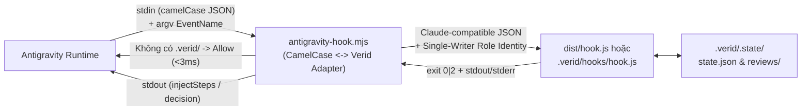

# Thiết kế tích hợp và tối ưu Token cho Verid trên Google Antigravity

[Về README](../README.vi.md) · [Rà soát Token](./token-efficiency-audit.vi.md) · [Bảng rule hook](./hook-reference.vi.md)

Tài liệu này mô tả thiết kế tích hợp **Verid (`aeriq`)** vào **Google Antigravity (AGY)** theo nguyên tắc **Zero Source Modification** (không sửa đổi code TypeScript trong `src/`), sử dụng hệ thống **Antigravity Plugin, Progressive Skills, Native Subagents và Lifecycle Hook Bridge** tại [`plugin/antigravity/`](../plugin/antigravity/) và `~/.gemini/config/plugins/verid/`.

---

## 1. Mục tiêu thiết kế

1. **Giữ nguyên 100% kỷ luật TDD và kiểm chứng bằng chứng của Verid:**
   - Cưỡng chế chu trình `RAW → COOKING → PLATED` trên từng lần ghi file (`write_file`, `edit_file`, `replace_file_content`, `multi_replace_file_content`) và lệnh shell (`run_command`).
   - Giữ nguyên kiểm tra chữ ký phê duyệt module (`verid order`), bằng chứng JUnit (`verid taste`), khóa file bảo vệ (`.verid/.state/`, `.verid/manifest.yaml`, `.verid/docs/`, `.agents/`, `~/.gemini/config/`) và nghiệm thu (`verid serve`).
2. **Tối ưu hóa triệt để lượng Token tiêu thụ trên Antigravity:**
   - Loại bỏ hoàn toàn hiện tượng nạp trùng `AGENTS.md`, đọc nhảy 2 bước (double-hop skill stubs), phình to danh mục 25 skills/14 agents ở mỗi turn, và chi phí khởi tạo 20 subagent contexts cho mỗi module.
3. **Không xâm phạm source code gốc (`src/`):**
   - Toàn bộ phần thích nghi nằm trong gói cấu hình [`plugin/antigravity/`](../plugin/antigravity/) và cài đặt độc lập tại `~/.gemini/config/plugins/verid/`.
   - Trong các project không có `.verid/`, plugin tự động đi qua ở chế độ no-op (`< 3ms`) và không can thiệp vào luồng làm việc bình thường.

---

## 2. Sáu cơ chế tối ưu Token cốt lõi trên Antigravity

| Cơ chế tối ưu                                                                | Cách làm cũ (Claude Code / Codex mặc định)                                                                                                                   | Thiết kế chuẩn cho Antigravity (`plugin/antigravity`)                                                                                                                                                                                                       | Tác động tới Token & Số vòng lặp (Turns)                                                                                                   |
| :--------------------------------------------------------------------------- | :----------------------------------------------------------------------------------------------------------------------------------------------------------- | :---------------------------------------------------------------------------------------------------------------------------------------------------------------------------------------------------------------------------------------------------------- | :----------------------------------------------------------------------------------------------------------------------------------------- |
| **1. Gộp danh mục 25 Skills + 14 Agents thành 8 Entry Skills + 3 Subagents** | Đưa toàn bộ 25 skills (~3.909 ký tự) và 14 agents vào danh mục nhận diện ở **mọi turn** gọi model.                                                           | Chỉ đăng ký **8 core skills** (`verid-onboard`, `ba`, `design`, `plan`, `build`, `debugging`, `review`, `router`) và **3 read-only subagents** (`verid-reviewer`, `security`, `debugger`). 17 domain packs nằm sau `verid-router`.                          | Giảm **~70% dung lượng danh mục `<skills>` & `<subagents>`** được gửi lặp lại trong system prompt ở mọi turn.                              |
| **2. Xóa bỏ Double-Hop Skill Stubs (`.agents/skills/`)**                     | Chế độ `resources: repo` của Codex tạo 25 file stub trong `.agents/skills/` chỉ để bảo AI đọc tiếp `.verid/skills/`.                                         | Dùng trực tiếp `SKILL.md` của plugin hoặc `.agents/skills.json` trỏ thẳng tới `.verid/skills`.                                                                                                                                                              | Tiết kiệm **1 tool call `read_file` + 1 turn gọi lại LLM** (gửi lại toàn bộ lịch sử chat) mỗi lần kích hoạt một skill.                     |
| **3. Rút gọn `rules/AGENTS.md` & cấm đọc lặp**                               | Block `AGENTS.md` dài 3.200–4.332 ký tự + native entry yêu cầu `Load AGENTS.md` bằng tool đọc file.                                                          | `rules/AGENTS.md` chỉ 1.150 ký tự (chứa TDD state machine & lệnh cốt lõi) + cấm gọi `read_file` lên `AGENTS.md` vì Antigravity đã tự nạp làm rule `always_on`.                                                                                              | Giảm **~68% kích thước rule cố định** mỗi turn và loại bỏ hoàn toàn chi phí đọc trùng `AGENTS.md` trong tool output.                       |
| **4. Single-Writer Build Loop (`main`) + Subagent Reviewer độc lập**         | Tách `tester` và `coder` thành subagent riêng cho từng AC (10 AC = 20 phiên subagent mới, mỗi phiên nạp lại system prompt, rules và đọc lại `tdd/SKILL.md`). | Luồng chính (`main`) trực tiếp viết test (ở `RAW`) và viết code (ở `COOKING`) dưới sự kiểm soát của `PreToolUse` hook. Chỉ gọi `invoke_subagent` khi cần **Review độc lập** (`verid-reviewer` / `verid-security`) hoặc điều tra lỗi sâu (`verid-debugger`). | Tránh khởi tạo **20 subagent contexts** cho mỗi module 10 AC, đồng thời giữ nguyên tính độc lập của Reviewer.                              |
| **5. Lệnh `/verid` 0-Token qua `PreInvocation` `terminate`**                 | Gõ lệnh kiểm tra trạng thái trong chat có thể kích hoạt 1 lượt model suy luận nếu không chặn ở tầng hook.                                                    | Khi gõ `/verid peek`, `/verid menu`, `/verid tip`, `/verid confirm`, `PreInvocation` trả về `errorMessage` kèm `"terminationBehavior": "terminate"`.                                                                                                        | Hiển thị kết quả ngay trên khung chat Antigravity với **0 input/output token gọi model**.                                                  |
| **6. Giới hạn Schema Tool của Subagent (`tools: [read_file]`)**              | Subagent mặc định nhận toàn bộ schema khai báo của các công cụ ghi file, chạy lệnh, quản lý task.                                                            | Khai báo `tools: [read_file]`, `subagent: true`, `mainAgent: false` trong frontmatter của `verid-reviewer.md`, `verid-security.md`, `verid-debugger.md`.                                                                                                    | Vừa khóa cứng quyền chỉ-đọc ở tầng nền tảng Antigravity, vừa loại bỏ toàn bộ JSON schema của các tool không dùng khỏi prompt của subagent. |

---

## 3. Kiến trúc Hook Bridge (`antigravity-hook.mjs`)

Antigravity sử dụng giao thức JSON **camelCase** trên `stdin`/`stdout` (không có trường `hook_event_name` trong payload), trong khi `dist/hook.js` của Verid sử dụng giao thức `snake_case` của Claude Code / Codex.

File [`plugin/antigravity/hooks/antigravity-hook.mjs`](../plugin/antigravity/hooks/antigravity-hook.mjs) đóng vai trò lớp cầu nối (adapter) không phụ thuộc thư viện ngoài:



### 3.1. Bảng ánh xạ Sự kiện (Lifecycle Events)

| Sự kiện Antigravity (`hooks.json`) | Sự kiện `dist/hook.js`                  | Xử lý tại `antigravity-hook.mjs`                                                                                                                                                                                                                                                    | JSON trả về cho Antigravity (`stdout`)                                                                                                                                                             |
| :--------------------------------- | :-------------------------------------- | :---------------------------------------------------------------------------------------------------------------------------------------------------------------------------------------------------------------------------------------------------------------------------------- | :------------------------------------------------------------------------------------------------------------------------------------------------------------------------------------------------- |
| `SessionStart`                     | `SessionStart`                          | Đọc trạng thái TDD (`RAW/COOKING/PLATED`), module đang mở, đường dẫn log và bước tiếp theo.                                                                                                                                                                                         | `{"injectSteps": [{"systemMessage": {"systemMessage": "..."}}]}`                                                                                                                                   |
| `PreInvocation`                    | `UserPromptSubmit`                      | Truyền `lastUserInput` với `CLAUDE_CODE_SESSION_ATTENDED=1`.<br>• Nếu là `/verid peek`, `menu`, `tip`, `confirm` (`exit === 2`): hiển thị ngay và dừng.<br>• Nếu thiếu `research.md`: tiêm nhắc nhở.                                                                                | • Lệnh `/verid`: `{"injectSteps": [{"errorMessage": {"userMessage": "..."}}], "terminationBehavior": "terminate"}`<br>• Nhắc nhở: `{"injectSteps": [{"systemMessage": {"systemMessage": "..."}}]}` |
| `PreToolUse`                       | `PreToolUse` (`+ SubagentStart`)        | 1. Kiểm tra bảo vệ `.agents/`, `~/.gemini/config/`, và `transcript.jsonl`.<br>2. Nếu `invoke_subagent` gọi `verid-reviewer` / `verid-security`: kích hoạt `SubagentStart` để chụp snapshot đầu vào.<br>3. Ánh xạ tool của Antigravity + Single-Writer role identity sang `hook.js`. | • Cho phép: `{"decision": "allow"}`<br>• Chặn (TDD / Policy): `{"decision": "deny", "reason": "..."}`                                                                                              |
| `PostToolUse`                      | `SubagentStop` (khi có review hoàn tất) | Kiểm tra `review_jobs` trong `state.json`; nếu subagent reviewer đã ghi `Verdict: pass\|fail` trong transcript, gọi `SubagentStop` để lưu báo cáo vào `.verid/.state/reviews/`.                                                                                                     | `{}`                                                                                                                                                                                               |
| `Stop`                             | `Stop` (`+ SubagentStop`)               | Hoàn tất pending review (nếu có), sau đó kiểm tra giữ phiên khi đang ở `COOKING`, `stub`, `dirty` (chưa chạy `verid taste`) hoặc còn AC chưa đạt.                                                                                                                                   | • Giữ phiên: `{"decision": "continue", "reason": "..."}`<br>• Cho dừng: `{"decision": "allow"}`                                                                                                    |

### 3.2. Bảng ánh xạ Công cụ (Tool Mapping) trong `PreToolUse`

| Tool của Antigravity                                              | Tham số đầu vào (`toolCall.args`)     | Ánh xạ sang `verid`              | Ghi chú xử lý đặc biệt                                                                                                                                                                             |
| :---------------------------------------------------------------- | :------------------------------------ | :------------------------------- | :------------------------------------------------------------------------------------------------------------------------------------------------------------------------------------------------- |
| `write_file`                                                      | `Path`, `Content`                     | `Write` (`file_path: args.Path`) | Kiểm tra TDD gate (`RAW/COOKING/PLATED`), plan approval, và protected paths.                                                                                                                       |
| `edit_file`, `replace_file_content`, `multi_replace_file_content` | `Path` hoặc `TargetFile`              | `Edit` (`file_path: ...`)        | Kiểm tra TDD gate và bảo vệ block `<!-- verid:begin/end -->` trong `AGENTS.md`.                                                                                                                    |
| `read_file`, `view_file`, `view_file_outline`, `view_code_item`   | `Path`, `AbsolutePath`, `File`        | `Read` (`file_path: ...`)        | Chặn đọc `.verid/.state/`, file bí mật (`.env`, keys) và `transcript.jsonl`.                                                                                                                       |
| `grep_search`                                                     | `SearchPath`                          | `Grep` (`path: ...`)             | Chặn tìm kiếm trong `.verid/.state/` và thư mục bảo vệ.                                                                                                                                            |
| `find_by_name`, `list_dir`                                        | `SearchDirectory`, `DirectoryPath`    | `Glob` (`path: ...`)             | Chặn duyệt `.verid/.state/`.                                                                                                                                                                       |
| `run_command`                                                     | `CommandLine`                         | `Bash` (`command: ...`)          | Trích xuất thêm các cmdlet ghi file của PowerShell trên Windows (`Set-Content`, `Add-Content`, `Out-File`, `Copy-Item`, `Move-Item`, `Remove-Item`) để `bashWrites()` kiểm tra dưới cùng TDD gate. |
| `invoke_subagent`                                                 | `TypeName`, `Role`, `Prompt`          | `Agent` (`subagent_type: ...`)   | Chuẩn hóa `verid-<name>` ↔ `verid:<name>` theo manifest; tự động phát `SubagentStart` khi gọi `verid-reviewer` hoặc `verid-security`.                                                              |
| `call_mcp_tool`                                                   | `ServerName`, `ToolName`, `Arguments` | `mcp__<Server>__<Tool>`          | Kiểm tra đường dẫn file trong `Arguments` qua `mcpFiles()`.                                                                                                                                        |

### 3.3. Cơ chế Single-Writer Role Bridge

Khi một project được khởi tạo bằng `verid cook` mặc định (`providers: ["claude-code"]`), `.verid/manifest.yaml` sẽ chứa cấu hình tách vai trò:

```yaml
roles:
  reviewer: ["verid:reviewer"]
  tester: ["verid:tester"]
  coder: ["verid:coder"]
```

Nếu không có cầu nối, khi luồng chính (`main`) của Antigravity trực tiếp ghi file test hoặc code để tiết kiệm token, `decideRole()` sẽ từ chối với lỗi `VERID_BURNT_ROLE_TESTER_ONLY` hoặc `VERID_BURNT_ROLE_CODER_ONLY`.

Trong `antigravity-hook.mjs`, hàm `resolveSingleWriterIdentity()` tự động kiểm tra:

- Nếu file đích là file test (`test/**`, `*.test.*`, `*.spec.*`, `e2e/**`): gắn định danh `tester` (hoặc `qa` cho `e2e`) từ `manifest.yaml`.
- Nếu file đích là code production (`src/**`...): gắn định danh `coder` từ `manifest.yaml`.
- Nếu file đích là `.verid/design.md` hoặc `.verid/plan.md`: gắn định danh `architect` / `planner` nếu có.

Nhờ đó:

- Luồng `main` trên Antigravity **không bị chặn bởi lỗi phân vai giả tạo**, không cần spawn 2 subagent cho mỗi AC.
- Ngược lại, **mọi quy tắc TDD (`decideTdd`) vẫn giữ nguyên 100% sức mạnh**:
  - Ghi code production khi đang ở `RAW` → bị chặn bởi `VERID_BURNT_TDD_NO_FAILING_TEST`.
  - Sửa file test khi đang ở `COOKING` → bị chặn bởi `VERID_BURNT_TDD_TEST_FROZEN`.
  - Ghi code khi chưa `verid order` → bị chặn bởi `VERID_BURNT_PLAN_NOT_APPROVED`.
- Nếu người dùng muốn ép Antigravity phải tách subagent `tester`/`coder` riêng, chỉ cần đặt biến môi trường `VERID_ANTIGRAVITY_SPLIT_ROLES=1`.

---

## 4. Cách thu thập số liệu Token thật trên Antigravity

Trong [`docs/token-efficiency-audit.vi.md`](./token-efficiency-audit.vi.md), điểm hạn chế trước đây là chưa có nơi đọc `input_tokens`, `output_tokens` và `cache_read_tokens` từ provider.

Trên Antigravity, mỗi phiên hội thoại (cả `main` lẫn từng `subagent`) đều ghi log JSONL tại:
`<ANTIGRAVITY_APP_DATA_DIR>/brain/<conversation-id>/.system_generated/logs/transcript.jsonl`

Mỗi dòng `type: "PLANNER_RESPONSE"` trong `transcript.jsonl` có sẵn 3 trường định lượng chính xác:

- `input_tokens`: Số token mới nạp vào ở bước đó.
- `cache_read_tokens`: Số token được đọc từ context cache.
- `output_tokens`: Số token model sinh ra (gồm `thinking` + `content` + `tool_calls`).

Developer có thể đo tổng lượng token của một phiên làm việc bất kỳ bằng lệnh PowerShell (chạy trong terminal của developer):

```powershell
$convId = "<conversation-id>"
$log = "$env:USERPROFILE\.gemini\antigravity\brain\$convId\.system_generated\logs\transcript.jsonl"
Get-Content $log | ForEach-Object { $_ | ConvertFrom-Json } |
  Where-Object { $_.type -eq "PLANNER_RESPONSE" } |
  Measure-Object -Property input_tokens, cache_read_tokens, output_tokens -Sum |
  Select-Object Property, Count, Sum
```

---

## 5. Hướng dẫn sử dụng thực tế

### Cách 1: Dùng Global Plugin (Khuyến nghị — bật sẵn cho mọi project)

Plugin đã được cài tại `~/.gemini/config/plugins/verid/`.

1. Trong bất kỳ project nào muốn dùng `verid`, mở terminal của developer và chạy:
   ```powershell
   verid cook --mode prep --workflow modular --provider codex --yes
   ```
   _(Hoặc dùng `node <path-to-aeriq>/dist/cli.js cook ...` nếu chưa cài global)._
2. Mở project trong **Antigravity**:
   - Hook `SessionStart` tự động nhận diện `.verid/.state/state.json` và nạp trạng thái TDD hiện tại.
   - Dùng các skill `verid-onboard`, `verid-ba`, `verid-design`, `verid-plan`, `verid-build`, `verid-debugging`, `verid-review`, `verid-router`.
   - Gõ `/verid peek` hoặc `/verid menu` trực tiếp vào khung chat bất kỳ lúc nào để xem tiến độ mà không tốn token.

### Cách 2: Đóng gói theo từng Repository (Workspace-Local)

Nếu muốn chia sẻ cấu hình Antigravity qua Git cùng repository của nhóm:

1. Chạy `verid cook --mode prep --workflow modular --resources repo --provider codex --yes`.
2. Xóa các file stub redirect trong `.agents/skills/` (do `codex` sinh ra) và chép mẫu `.agents/skills.json` từ [`plugin/antigravity/workspace-template/.agents/skills.json`](../plugin/antigravity/workspace-template/.agents/skills.json) vào `.agents/skills.json` của project.
3. Chép `hooks.json`, `hooks/antigravity-hook.mjs` và `agents/*.md` từ [`plugin/antigravity/`](../plugin/antigravity/) vào `.agents/` của project.
