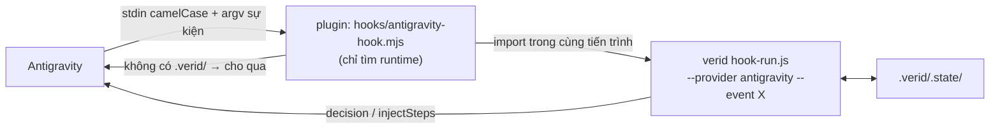

# Tích hợp Verid với Google Antigravity

[Về README](../README.vi.md) · [Rà soát Token](./token-efficiency-audit.vi.md) · [Bảng rule hook](./hook-reference.vi.md)

Antigravity là provider thứ ba của verid, ngang hàng với Claude Code và Codex: `providers: ["antigravity"]` trong `.verid/manifest.yaml`, `verid cook --provider antigravity`, `verid setup-antigravity` và `verid doctor`. Lõi verid (`src/adapters/antigravity.ts`) tự đọc payload camelCase của Antigravity và trả lời đúng định dạng của nó; plugin [`plugin/antigravity/`](../plugin/antigravity/) chỉ đăng ký hook, skill và subagent.

---

## 1. Mục tiêu

1. **Cùng một bộ luật cho mọi provider.** TDD `RAW → COOKING → PLATED`, phê duyệt module (`verid order`), bằng chứng JUnit (`verid taste`), file được bảo vệ và review độc lập chạy đúng code đã dùng cho Claude Code và Codex. Không có bản sao luật nào trong plugin.
2. **Single-writer.** Luồng chính viết cả test lẫn code dưới cổng TDD, như trên Codex; subagent chỉ dành cho vai trò chỉ-đọc (`verid-reviewer`, `verid-security`). Không giả mạo danh tính tester/coder.
3. **Rẻ token và nhanh.** Một tiến trình `node` cho mỗi hook (shim nạp hook ngay trong tiến trình), lệnh `/verid` trong chat không tốn lượt model, và project không có `.verid/` được cho qua ngay.

---

## 2. Sáu cơ chế tối ưu Token cốt lõi trên Antigravity

| Cơ chế tối ưu                                                                | Cách làm cũ (Claude Code / Codex mặc định)                                                                                                                   | Thiết kế chuẩn cho Antigravity (`plugin/antigravity`)                                                                                                                                                                                                       | Tác động tới Token & Số vòng lặp (Turns)                                                                                                   |
| :--------------------------------------------------------------------------- | :----------------------------------------------------------------------------------------------------------------------------------------------------------- | :---------------------------------------------------------------------------------------------------------------------------------------------------------------------------------------------------------------------------------------------------------- | :----------------------------------------------------------------------------------------------------------------------------------------- |
| **1. Gộp danh mục 25 Skills + 14 Agents thành 8 Entry Skills + 3 Subagents** | Đưa toàn bộ 25 skills (~3.909 ký tự) và 14 agents vào danh mục nhận diện ở **mọi turn** gọi model.                                                           | Chỉ đăng ký **8 core skills** (`verid-onboard`, `ba`, `design`, `plan`, `build`, `debugging`, `review`, `router`) và **3 read-only subagents** (`verid-reviewer`, `security`, `debugger`). 17 domain packs nằm sau `verid-router`.                          | Giảm **~70% dung lượng danh mục `<skills>` & `<subagents>`** được gửi lặp lại trong system prompt ở mọi turn.                              |
| **2. Xóa bỏ Double-Hop Skill Stubs (`.agents/skills/`)**                     | Chế độ `resources: repo` của Codex tạo 25 file stub trong `.agents/skills/` chỉ để bảo AI đọc tiếp `.verid/skills/`.                                         | Dùng trực tiếp `SKILL.md` của plugin hoặc `.agents/skills.json` trỏ thẳng tới `.verid/skills`.                                                                                                                                                              | Tiết kiệm **1 tool call `read_file` + 1 turn gọi lại LLM** (gửi lại toàn bộ lịch sử chat) mỗi lần kích hoạt một skill.                     |
| **3. Rút gọn `rules/AGENTS.md` & cấm đọc lặp**                               | Block `AGENTS.md` dài 3.200–4.332 ký tự + native entry yêu cầu `Load AGENTS.md` bằng tool đọc file.                                                          | `rules/AGENTS.md` chỉ 1.150 ký tự (chứa TDD state machine & lệnh cốt lõi) + cấm gọi `read_file` lên `AGENTS.md` vì Antigravity đã tự nạp làm rule `always_on`.                                                                                              | Giảm **~68% kích thước rule cố định** mỗi turn và loại bỏ hoàn toàn chi phí đọc trùng `AGENTS.md` trong tool output.                       |
| **4. Single-Writer Build Loop (`main`) + Subagent Reviewer độc lập**         | Tách `tester` và `coder` thành subagent riêng cho từng AC (10 AC = 20 phiên subagent mới, mỗi phiên nạp lại system prompt, rules và đọc lại `tdd/SKILL.md`). | Luồng chính (`main`) trực tiếp viết test (ở `RAW`) và viết code (ở `COOKING`) dưới sự kiểm soát của `PreToolUse` hook. Chỉ gọi `invoke_subagent` khi cần **Review độc lập** (`verid-reviewer` / `verid-security`) hoặc điều tra lỗi sâu (`verid-debugger`). | Tránh khởi tạo **20 subagent contexts** cho mỗi module 10 AC, đồng thời giữ nguyên tính độc lập của Reviewer.                              |
| **5. Lệnh `/verid` 0-Token qua `PreInvocation` `terminate`**                 | Gõ lệnh kiểm tra trạng thái trong chat có thể kích hoạt 1 lượt model suy luận nếu không chặn ở tầng hook.                                                    | Khi gõ `/verid peek`, `/verid menu`, `/verid tip`, `/verid confirm`, `PreInvocation` trả về `errorMessage` kèm `"terminationBehavior": "terminate"`.                                                                                                        | Hiển thị kết quả ngay trên khung chat Antigravity với **0 input/output token gọi model**.                                                  |
| **6. Giới hạn Schema Tool của Subagent (`tools: [read_file]`)**              | Subagent mặc định nhận toàn bộ schema khai báo của các công cụ ghi file, chạy lệnh, quản lý task.                                                            | Khai báo `tools: [read_file]`, `subagent: true`, `mainAgent: false` trong frontmatter của `verid-reviewer.md`, `verid-security.md`, `verid-debugger.md`.                                                                                                    | Vừa khóa cứng quyền chỉ-đọc ở tầng nền tảng Antigravity, vừa loại bỏ toàn bộ JSON schema của các tool không dùng khỏi prompt của subagent. |

---

## 3. Kiến trúc



Shim ưu tiên runtime ghim trong project (`.verid/hooks/hook-run.js`, khi `resources: repo`), sau đó tới bundle cài cùng plugin (`<plugin>/dist/hook-run.js`). Không có runtime thì mọi tool call bị từ chối.

Trong lõi, mỗi provider là một `Host` (`src/adapters/host.ts`): cách đọc payload, cách trả lời, single-writer hay không, có nhận `/verid tip` hay không. Luật trong `src/hook/` chỉ hỏi khả năng của host, không hỏi tên host.

### 3.1. Sự kiện

| Antigravity     | verid xử lý như                      | Trả lời                                                                                                         |
| :-------------- | :----------------------------------- | :-------------------------------------------------------------------------------------------------------------- |
| `SessionStart`  | `SessionStart`                       | `{"injectSteps":[{"systemMessage":{...}}]}`: chu trình TDD, vai trò, bước tiếp theo.                            |
| `PreInvocation` | `UserPromptSubmit`, một lần mỗi turn | `/verid peek\|menu\|tip\|confirm`: `errorMessage` cho developer + `"terminationBehavior":"terminate"`.          |
| `PreToolUse`    | `PreToolUse` (+ `SubagentStart`)     | `{"decision":"allow"}` hoặc `{"decision":"deny","reason":"verid [MÃ] ..."}`.                                    |
| `PostToolUse`   | `SubagentStop` cho `invoke_subagent` | `{}`; báo cáo kết thúc bằng `Verdict: pass\|fail` được ghi thành review.                                        |
| `Stop`          | `Stop`                               | `{"decision":"continue","reason":...}` khi còn việc chưa kiểm chứng; lần dừng kế tiếp trong cùng turn được qua. |

Antigravity gọi `PreInvocation` trước mỗi lượt model trong một turn. verid chỉ xử lý lượt đầu (theo `executionNum` và nội dung prompt), nên `/verid confirm` không bị dùng hai lần và lời nhắc không bị tiêm lặp.

### 3.2. Công cụ

| Tool của Antigravity                                              | verid xét như                           | Ghi chú                                                                             |
| :---------------------------------------------------------------- | :-------------------------------------- | :---------------------------------------------------------------------------------- |
| `write_to_file`, `write_file`, `create_file`                      | `Write` (`TargetFile`/`Path`, nội dung) | Cổng TDD, phê duyệt module, file bảo vệ, block `AGENTS.md`.                         |
| `replace_file_content`, `multi_replace_file_content`, `edit_file` | `Edit`                                  | Sửa `AGENTS.md` không kiểm chứng được nội dung nên bị từ chối nếu chạm block verid. |
| `view_file`, `read_file`, `view_file_outline`, `view_code_item`   | `Read`                                  | Chặn `.verid/.state/`, file bí mật, transcript.                                     |
| `grep_search`, `codebase_search` / `find_by_name`, `list_dir`     | `Grep` / `Glob`                         |                                                                                     |
| `run_command`                                                     | `Bash`, đọc theo cả sh và PowerShell    | `Cwd` được dùng để giải đường dẫn. Lệnh PowerShell không đọc được thì bị từ chối.   |
| `send_command_input`                                              | shell không đọc được                    | Bị từ chối (developer có thể mở ngoại lệ bằng `/verid tip`).                        |
| `invoke_subagent`                                                 | `Agent` (`TypeName`)                    | Khi được cho qua, verid chụp snapshot review cho đúng lời gọi đó (`toolCall.id`).   |
| `call_mcp_tool`                                                   | `mcp__<Server>__<Tool>`                 | Đường dẫn trong `Arguments` được xét như MCP tool.                                  |
| Tool khác                                                         | theo tên và đường dẫn trong tham số     | Tool có tên "ghi" mà không tìm thấy đường dẫn: `VERID_BURNT_TOOL_UNSUPPORTED`.      |

### 3.3. Review độc lập

1. `invoke_subagent` tới `verid-reviewer` được cho qua → verid chụp snapshot đầu vào review, gắn với `toolCall.id`.
2. Khi chính lời gọi đó trả về (`PostToolUse`), verid lấy báo cáo kết thúc bằng `Verdict: pass|fail` và ghi review.
3. Báo cáo của lời gọi khác, của hội thoại khác, hoặc sau khi code đã đổi thì không được tính (`REVIEW_STALE`).

### 3.4. Đường dẫn được bảo vệ thêm

- Ghi vào `.agents/` của project và `~/.gemini/config/` (nơi đăng ký plugin và hook).
- Đọc hoặc ghi transcript Antigravity: `~/.gemini/antigravity/brain/*/.system_generated/` và `~/.gemini/antigravity/conversations/`. Artifact của hội thoại vẫn ghi được.

Các luật này áp dụng cho mọi provider: một agent Claude Code cũng không thể sửa hook Antigravity để tắt verid ở phía bên kia.

---

## 4. Cách thu thập số liệu Token thật trên Antigravity

Trong [`docs/token-efficiency-audit.vi.md`](./token-efficiency-audit.vi.md), điểm hạn chế trước đây là chưa có nơi đọc `input_tokens`, `output_tokens` và `cache_read_tokens` từ provider.

Trên Antigravity, mỗi phiên hội thoại (cả `main` lẫn từng `subagent`) đều ghi log JSONL tại:
`<ANTIGRAVITY_APP_DATA_DIR>/brain/<conversation-id>/.system_generated/logs/transcript.jsonl`

Mỗi dòng `type: "PLANNER_RESPONSE"` trong `transcript.jsonl` có sẵn 3 trường định lượng chính xác:

- `input_tokens`: Số token mới nạp vào ở bước đó.
- `cache_read_tokens`: Số token được đọc từ context cache.
- `output_tokens`: Số token model sinh ra (gồm `thinking` + `content` + `tool_calls`).

Developer có thể đo tổng lượng token của một phiên làm việc bất kỳ bằng lệnh PowerShell (chạy trong terminal của developer):

```powershell
$convId = "<conversation-id>"
$log = "$env:USERPROFILE\.gemini\antigravity\brain\$convId\.system_generated\logs\transcript.jsonl"
Get-Content $log | ForEach-Object { $_ | ConvertFrom-Json } |
  Where-Object { $_.type -eq "PLANNER_RESPONSE" } |
  Measure-Object -Property input_tokens, cache_read_tokens, output_tokens -Sum |
  Select-Object Property, Count, Sum
```

---

## 5. Cách dùng

1. Cài plugin một lần trên mỗi máy, trong terminal của developer:
   ```sh
   verid setup-antigravity
   ```
   Lệnh chép plugin, skill, agent và bundle hook vào `~/.gemini/config/plugins/verid/`. Chạy lại sau mỗi lần cập nhật verid. Khởi động lại Antigravity.
2. Khởi tạo project:
   ```sh
   verid cook --provider antigravity --mode prep --yes
   ```
   Dùng `--mode remix` cho sửa lỗi nhỏ trên code có sẵn, thêm `--provider claude-code` nếu nhóm dùng cả hai. Ba preset trong [`plugin/antigravity/presets/`](../plugin/antigravity/presets/) là manifest mẫu hợp lệ.
3. Kiểm tra: `verid doctor` báo plugin đã cài.
4. Trong Antigravity: gõ `/verid peek` hoặc `/verid menu` trong chat để xem trạng thái (không tốn token), `/verid tip <lý do>` rồi `/verid confirm <mã>` khi cần ngoại lệ.

### Giới hạn đã biết

- Định dạng payload dựa trên những gì bridge cũ giả định; chưa có fixture ghi lại từ Antigravity thật như `test/fixtures/codex/`. Nếu Antigravity đặt tên trường khác (ví dụ không gửi `toolCall.id` hoặc kết quả `invoke_subagent` trong `PostToolUse`), review sẽ không được ghi nhận: an toàn, nhưng cần fixture để sửa.
- Ở big-brain drive của prep/recipe, tool call của subagent mang `conversationId` riêng nên có thể bị coi là session khác.
- Antigravity chưa có biến môi trường đánh dấu shell của agent, nên `verid` không tự nhận ra nó đang chạy trong agent; các lệnh chỉ dành cho developer vẫn bị chặn bằng luật shell.
