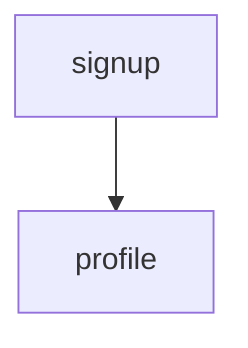

# `.verid/design.md` format

How the product is built, agreed section by section with the developer. It follows
`.verid/research.md` and `.verid/spec.md` and the profile in `.verid/rules/architecture.md`.
Write "none" rather than leave a section out.

# Design: <project>

## Architecture decisions

Decide the choices that bind every module first, one question at a time with 2–3 options
each: deployment (monolith, modular monolith, services), communication (in-process,
REST, events, queue), data ownership (shared store or one per module), identity and
auth, repo layout, and cross-cutting errors, configuration, logging and testing.

| Decision | Chosen | Why | Rejected |
| :------- | :----- | :-- | :------- |

## Existing code

What the code already has that this design touches: tables written, side effects and
shared services, each as `path:line` with reuse, extend, supersede or duplicate; or
"none", with the search that found nothing.

## Boundaries

For DDD, the bounded contexts and layers; adapt it to the chosen profile.

| Context or layer | Paths | Public API | May depend on |
| :--------------- | :---- | :--------- | :------------ |

## Module map

The delivery slices the plan turns into modules, in an order that works: a module
depends only on modules above it, and the plan copies this column into `Depends:`.

| Module | Responsibility | Interfaces | Depends | Repos | Size |
| :----- | :------------- | :--------- | :------ | :---- | :--- |

## Data

Entities, who owns each one, and schema or migration changes.

## Interfaces

Each interface a module exposes or consumes: name, shape, errors, and which module owns
it.

## Tradeoffs

What this design gives up, and why that is acceptable now.

## Out of scope

What this design deliberately leaves out.
